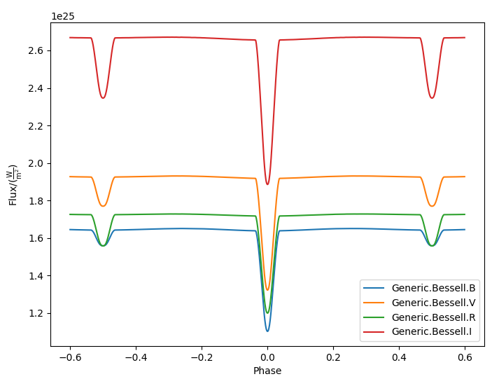

#  ELISa

[](https://www.python.org/)
[](https://www.gnu.org/licenses/gpl-3.0.html)
[](https://github.com/mikecokina/elisa/commits/feature/optimizations)
[](https://pypi.org/project/setuptools/)
[](https://en.wikipedia.org/wiki/Operating_system)


## Publications

[ELISa: A new tool for fast modelling of eclipsing binaries](https://arxiv.org/abs/2106.10116)

## Introduction

**ELISa** is a cross-platform Python package for modeling the light curves of close eclipsing binary systems, including surface features such as spots. Low-amplitude pulsations are modeled using spherical harmonics.

Current capabilities include:

- **`BinarySystem`** - modeling detached, semi-detached, and over-contact binary systems
- **`SingleSystem`** - modeling single-star light curves with spot and pulsation support
- **`Observer`** - generating synthetic light curves and radial velocity curves
- **`Spots`** - defining stellar spots by longitude, latitude, radius, and temperature factor
- **`Pulsations`** - low-amplitude pulsations modeled using spherical harmonics
- **`Fitting methods`** - fitting light curves and radial velocity curves using:
  - non-linear least squares
  - Markov Chain Monte Carlo (MCMC)
- **`Radial velocity modeling`** - including the Rossiter-McLaughlin effect and RV variations due to spots (and pulsations where applicable)

ELISa is under active development. Work in progress includes:

- extending **LC** and **RV** fitting with additional methods and utilities, including automated classification of eclipsing binaries using neural networks to support solving the inverse problem

Planned features include:

- synthetic spectral line modeling


## Installation

ELISa requires **Python 3.11 or newer**.

It is strongly recommended to install ELISa inside a virtual environment.

### 1. Create and activate a virtual environment

```bash
python -m venv .venv
source .venv/bin/activate        # Linux / macOS
# .venv\Scripts\activate         # Windows
```

Upgrade pip:

```bash
python -m pip install --upgrade pip
```

---

### 2. Install ELISa

Install the latest stable release from PyPI:

```bash
pip install elisa
```

Install the current development source (version **1.0.0.dev0**) from GitHub:

```bash
pip install git+https://github.com/mikecokina/elisa.git@feature/optimizations
```

---

For editable development installation from a local checkout of this branch:

```bash
pip install -e ".[dev,test]"
```

The `dev`, `test`, and `ui` extras provide development tools, test tools, and the desktop UI, respectively.
The stable PyPI release may differ from the development source documented here.

### Optional: Jupyter Notebooks

To run example notebooks:

```bash
pip install jupyterlab ipykernel
```

Then launch:

```bash
jupyter lab
```


## Configuration

### Minimal Configuration

Starting from version **0.6**, ELISa includes a built-in **Settings Manager** and **Download Manager** to simplify first-time setup.

When ELISa is executed for the first time and no configuration file is detected, a setup wizard will guide you through the basic configuration process. The wizard offers the following default configuration path:

```
~/.elisa/config.ini
```

The wizard will prompt you to:

- Select directories for storing atmosphere models and limb darkening tables  
- Confirm downloading the scientific tables after configuration (declining exits the first import)

This allows most users to get started without any manual configuration.

---

### Manual Configuration

Tabulated atmosphere models require the corresponding atmosphere files; limb darkening tables are also needed unless coefficients are supplied explicitly. Blackbody synthesis does not require atmosphere tables.

You can download them from:

- Atmosphere models:  
  https://github.com/mikecokina/elisa-assets/tree/main/atmosphere
- Limb darkening tables:  
  https://github.com/mikecokina/elisa-assets/tree/main/limbdarkening

---

### Default Data Locations

By default, ELISa searches for data files in:

- CK04 atmospheres: `$HOME/.elisa/atmosphere/ck04/`
- K93 atmospheres: `$HOME/.elisa/atmosphere/k93/`
- Limb darkening tables: `$HOME/.elisa/limbdarkening/ld/`

These are the default data paths; a configuration file is still needed to bypass the first-run wizard.

---

### Custom Data Locations

You may store atmosphere models and limb darkening tables in any directory of your choice.

For example:

- Atmospheres: `/home/user/castelli_kurucz/ck04`
- Limb darkening: `/home/user/ld/`

Create a configuration file, for example:

```
/home/user/.elisa/elisa_config.ini
```

With minimal content such as:

```ini
[support]
ld_tables = /home/user/ld
castelli_kurucz_04_atm_tables = /home/user/castelli_kurucz/ck04
```

A complete configuration reference is available here:

[Configuration reference](./src/elisa/conf/elisa_conf_docs.ini)

---

### Important Note on Data Format

Atmosphere models and limb darkening tables are stored in standard `.csv` format.  
However, their native format is not directly compatible with ELISa.  
The provided datasets have been converted to a format required by ELISa.

---

### Specifying a Custom Configuration File

If you are not using the default configuration path, set the environment variable `ELISA_CONFIG` to point to your configuration file.

On Linux or macOS:

```bash
export ELISA_CONFIG=/home/user/.elisa/elisa_config.ini
```

You can place this command in your shell configuration file (for example, `.bashrc` or `.zshrc`) to make it persistent.

On Windows (PowerShell):

```powershell
$env:ELISA_CONFIG = "C:\Users\user\.elisa\elisa_config.ini"
```

Configuration lookup uses the first existing file in this order: `ELISA_CONFIG`,
`$VIRTUAL_ENV/conf/elisa_conf.ini`, then `~/.elisa/config.ini`.
A nonexistent `ELISA_CONFIG` path falls back to the other locations.

---

Once configured, ELISa is ready to use.


## Physics

For a detailed description of the physical assumptions and numerical methods used in ELISa,  
please refer to the **ELISa Handbook**:

[ELISa Handbook](./ELISa_handbook.pdf)

The handbook describes ELISa 0.5.0 (2021). It remains a scientific reference, but some implementation and API details differ from the current version.

The handbook explains the modeling of single stars and binary systems, including surface discretization, 
radiative treatment, orbital dynamics, and observable synthesis.

---

## Available Passbands

ELISa can currently model light curves in the following photometric filters:

```
bolometric
Generic.Bessell.U
Generic.Bessell.B
Generic.Bessell.V
Generic.Bessell.R
Generic.Bessell.I
SLOAN.SDSS.u
SLOAN.SDSS.g
SLOAN.SDSS.r
SLOAN.SDSS.i
SLOAN.SDSS.z
Generic.Stromgren.u
Generic.Stromgren.v
Generic.Stromgren.b
Generic.Stromgren.y
Kepler
Gaia.2010.G
Gaia.2010.BP
Gaia.2010.RP
TESS
```

Support for additional passbands may be added in future releases.

---

## Multiprocessing

ELISa supports parallel computation of light curves to improve performance on multi-core systems.

During multiprocessing, the requested light curve points are divided into smaller batches, 
and each batch is evaluated on a separate CPU core.

### Important Considerations

- Parallelization introduces computational overhead.
- For simple systems (e.g., circular, synchronous, spot-free binaries), multiprocessing may not provide a speed benefit.
- Performance gains depend strongly on system complexity and hardware.

In general, multiprocessing is most effective for:

- Eccentric orbits  
- Systems with surface spots  
- Systems requiring expensive radiative computations  

Careful benchmarking on your target system is recommended to determine whether multiprocessing 
improves performance for your specific use case.


## Examples

### Building a Simple Binary System Model (Minimal Working Example)

ELISa allows fast construction of binary system models using parameters provided as a Python dictionary (or JSON).  

Model parameters are grouped into three sections:

- `system`
- `primary`
- `secondary`

You can define the system either by:

- specifying component masses using the `mass` parameter, **or**
- providing `mass_ratio` together with `semi_major_axis`

Example:

```python
from elisa import BinarySystem

community_params = {
    "system": {
        "inclination": 86.0,
        "period": 10.1,
        "argument_of_periastron": 90.0,
        "gamma": 0.0,
        "eccentricity": 0.0,
        "primary_minimum_time": 0.0,
        "phase_shift": 0.0,
        "semi_major_axis": 10.5,  # default unit: solar radii
        "mass_ratio": 0.5
    },
    "primary": {
        "surface_potential": 7.1,
        "synchronicity": 1.0,
        "t_eff": "6500.0 K",  # values may use astropy-compatible unit strings
        "gravity_darkening": 1.0,
        "albedo": 1.0,
        "metallicity": 0.0
    },
    "secondary": {
        "surface_potential": 7.1,
        "synchronicity": 1.0,
        "t_eff": 5000.0,
        "gravity_darkening": 1.0,
        "albedo": 1.0,
        "metallicity": 0.0
    }
}

community_binary = BinarySystem.from_json(community_params)
```

Each component defaults to the `ck04` atmosphere. Set `"atmosphere": "ck04"`,
`"atmosphere": "k93"`, or `"atmosphere": "black_body"` in its parameter dictionary
to choose its model independently. The light curve example below requires CK04
atmosphere and limb darkening tables. Bare periods are in days, angles in degrees,
temperatures in kelvin, and component masses (when supplied) in solar masses.

See Tutorials 1-4 for a detailed explanation of system construction and parameter choices.

---

### Calculating a Light Curve

Once the binary system is defined, you can generate synthetic observations using the `Observer` class:

```python
from elisa import Observer

o = Observer(
    passband=[
        "Generic.Bessell.B",
        "Generic.Bessell.V",
        "Generic.Bessell.R",
        "Generic.Bessell.I"
    ],
    system=community_binary
)

# Generate a light curve with 1200 phase points
phases, fluxes = o.observe.lc(
    from_phase=-0.6,
    to_phase=0.6,
    phase_step=0.001,
    # normalize=True  # Uncomment to normalize flux to unity
)
```

By default, fluxes are absolute observer fluxes in W/m², scaled by the system distance
(default 10 pc). Set `normalize=True` to normalize each passband to its maximum.

The return values:

- `phases` - orbital phase values  
- `fluxes` - dictionary mapping each passband name to its flux array

This provides a complete minimal workflow: define the system, instantiate the observer, and generate synthetic light curves.


## Visualization

ELISa includes a built-in visualization interface for convenient inspection of model results.

For example, a light curve computed with an `Observer` instance `o` can be displayed using:

```python
o.plot.lc()
```



The plotting interface supports visualization of multi-passband light curves and other model outputs.

---

## Desktop UI

ELISa ships with an interactive desktop application built on [Gradio](https://www.gradio.app/). It covers the full
workflow - modeling, fitting, and visualization - without writing any code.

Install the UI extra from the current source checkout:

```bash
pip install -e ".[ui]"
```

**Launch the UI:**

```bash
python -m elisa.ui
```

The app opens in your browser at `http://localhost:7860` and provides five tabs:

- **Light Curve Modeling** - generate synthetic light curves
- **Radial Velocity Modeling** - generate synthetic RV curves (kinematic or radiometric method)
- **Light Curve Fitting** - fit observed LC data using least squares or MCMC
- **Radial Velocity Fitting** - fit observed RV data using least squares or MCMC
- **System Visualization** - render surface, mesh, orbit, and equipotential plots

For full usage instructions, parameter descriptions, and worked examples see
**[UI_GUIDE.md](./UI_GUIDE.md)**.

---

## Solving the Inverse Problem

ELISa provides built-in functionality for inferring binary system parameters from observational data. Similar to the 
binary system construction demonstrated above, the fitting parameters are supplied as a dictionary (or JSON object) in 
the following format:

```text
fit_params = {
    "system": {
        "mass_ratio": {...},
        "eccentricity": {...},
        ...
    },
    "primary": {
        "surface_potential": {...},
        ...
    },
    "secondary": {
        "surface_potential": {...},
        ...
    },
    "nuisance": {  # used only for MCMC
        "ln_f": {...}
    }
}
```

Each model parameter (e.g., `mass_ratio`) is defined as a dictionary that specifies its role and behavior during the 
fitting procedure. ELISa recognizes three main types of model parameters.

### Parameter Types

ELISa supports three types of parameters:

#### 1. Fixed

The parameter remains constant during optimization.

```python
{"t_eff": {
    "value": 5774,
    "fixed": True,
    "unit": "K"
}}
```

---

#### 2. Variable

The parameter is optimized within a specified interval.

```python
{"surface_potential": {
    "value": 5.2,     # initial value
    "fixed": False,
    "min": 4.0,
    "max": 7.0,
    "unit": None      # optional
}}
```

For MCMC fitting, parameters may also use Gaussian priors within finite bounds
(explicit bounds or parameter defaults); `sigma` must be finite and positive:

```python
{"t_eff": {
    "value": 6300,     # mean
    "sigma": 400,      # standard deviation
    "fixed": False,
    "min": 3500,       # finite lower bound
    "max": 50000,      # finite upper bound
    "unit": "K"
}}
```

---

#### 3. Constrained

The parameter is computed from other parameters during optimization.

```python
{"semi_major_axis": {
    "value": 16.515,
    "constraint": "16.515 / sin(radians(system@inclination))"
}}
```

This feature is particularly useful when incorporating parameters such as `a sin(i)`, derived from radial velocity fitting, 
into light curve fitting in order to constrain the system’s `semi-major` axis through its inclination.

---

## Running a Fit

Once the model parameters are defined, the optimization task can be initialized using one of the available fitting methods. 
The following example demonstrates how to initialize a task for light curve fitting:

```python
from elisa.analytics import LCData, LCBinaryAnalyticsTask

# phased and normalized (to 1) light curve observed by the Kepler
kepler_data = LCData.load_from_file(
    filename="path/to/your/data.dat",
    x_unit=None,
    y_unit=None
)

task = LCBinaryAnalyticsTask(
    data={"Kepler": kepler_data},
    method="least_squares",
    expected_morphology="detached"
)
```


Observational data are provided in a custom Dataset format, defined separately for each filter. The optimization task 
currently supports the least_squares and mcmc methods. The `least-squares` method is intended for rapid determination 
of a local minimum near the initial parameter values. In contrast, the `MCMC` method is primarily used to estimate 
confidence intervals for model parameters around the solution obtained from the `least-squares` fit.

For light curve fitting, the optimizer requires the `expected_morphology` of the system, with the available options 
being `detached` and `over-contact`.

**Supported optimization methods:**

- `"least_squares"` - fast local optimization  
- `"mcmc"` - parameter estimation and confidence interval evaluation  

**The `expected_morphology` argument currently supports**:

- `"detached"`
- `"over-contact"`

---

## Observational Uncertainties

LC and RV datasets accept `y_err=None` in both least squares and MCMC. Supplied
uncertainties must be finite, strictly positive, one-dimensional arrays matching
`y_data`. Observations and coordinates must be nonempty, finite, matching vectors.
Malformed file rows raise an error rather than being silently discarded; use
`data_columns=(0, 1)` for two-column files without uncertainties. Smoothing preserves
`y_err=None` when errors were omitted.

When uncertainties are omitted, fitting setup estimates a constant scale separately
for each passband or RV component:

- LC: `0.05 * abs(mean(flux))`, after magnitude conversion and before normalization.
  Fitting divides both flux and its uncertainties by the same positive mean flux.
- RV: `0.05 * 1.482602218505602 * median(abs(v - median(v)))`. If ties make MAD zero
  despite nonzero variation, the fallback is `0.05 * std(v, ddof=1)`. The latter
  fallback is sensitive to outliers. Constant, singleton or numerically unresolved
  RV data require explicit positive errors; no absolute velocity floor is added.

The RV estimate is invariant under an additive velocity offset, within floating-point
rounding. It retains small representable variation; offsets that erase variation in
the input cannot be undone. The factor 0.05 is a compatibility convention. These
scales include astrophysical variability and do not estimate instrument precision.
Each estimate emits a warning: these are heuristic weights, not calibrated measurement
uncertainties. MCMC posterior credible intervals depend on the assumed uncertainties,
priors and likelihood. Supply measured errors for scientific inference.

For magnitude or mmag data, supply errors in the same unit and set
`reference_magnitude`. The existing Gaussian-flux approximation is propagated
pointwise as `sigma_F = ln(10)/2.5 * F * sigma_mag`; mmag errors are divided by 1000
first. Direct callers of `convert_flux_error` must now supply the converted pointwise
`flux` as well as the reference `zero_point`; the zero point alone cannot determine
absolute flux uncertainties.

## Executing the Fit

The fitting procedure can then be initiated with the following command:

```python
# Supply a complete fit_params dictionary; the schematic above is not executable.
task.fit(x0=fit_params)
task.save_result("result.json")
```

Results can be summarized with:

```python
task.fit_summary()
```

The summary table includes:

- System parameters
- Component parameters
- Derived quantities
- Parameter status (Fixed, Variable, Derived, Constrained)
- Uncertainties (for MCMC)

**Example:**

```text
BINARY SYSTEM
Parameter                                          value            -1 sigma            +1 sigma                unit    status
------------------------------------------------------------------------------------------------------------------------------
Mass ratio (q=M_2/M_1):                             1.08                   -                   -                None    Fixed
Semi major axis (a):                               11.53                   -                   -              solRad    11.2 / sin(radians(system@inclination))
Inclination (i):                                   76.26                   -                   -                 deg    Variable
Eccentricity (e):                                   0.03                   -                   -                None    Variable
Argument of periastron (omega):                   197.93                   -                   -                 deg    Variable
Orbital period (P):                              2.47028                   -                   -                   d    Fixed
Additional light (l_3):                            0.014                   -                   -                None    Variable
Phase shift:                                   7.378e-05                   -                   -                None    Variable
------------------------------------------------------------------------------------------------------------------------------
PRIMARY COMPONENT
Parameter                                          value            -1 sigma            +1 sigma                unit    status
------------------------------------------------------------------------------------------------------------------------------
Mass (M_1):                                         1.62                   -                   -             solMass    Derived
Surface potential (Omega_1):                      5.8397                   -                   -                None    Variable
Critical potential at L_1:                        4.0162                   -                   -                   -    Derived
Synchronicity (F_1):                               1.067                   -                   -                None    (1 + system@eccentricity)**2 / (1 - system@eccentricity**2)**(3.0/2.0)
Polar gravity (log g):                             3.888                   -                   -            log(cgs)    Derived
Equivalent radius (R_equiv):                     0.21168                   -                   -                 SMA    Derived

Periastron radii
Polar radius:                                    0.20899                   -                   -                 SMA    Derived
Backward radius:                                 0.21457                   -                   -                 SMA    Derived
Side radius:                                      0.2113                   -                   -                 SMA    Derived
Forward radius:                                  0.21583                   -                   -                 SMA    Derived

Atmospheric parameters
Effective temperature (T_eff1):                   7022.0                   -                   -                   K    Fixed
Bolometric luminosity (L_bol):                     13.05                   -                   -               L_Sol    Derived
Gravity darkening factor (G_1):                      1.0                   -                   -                None    Fixed
Albedo (A_1):                                        1.0                   -                   -                None    Fixed
Metallicity (log10(X_Fe/X_H)):                       0.0                   -                   -                None    Fixed
------------------------------------------------------------------------------------------------------------------------------
SECONDARY COMPONENT
Parameter                                          value            -1 sigma            +1 sigma                unit    status
------------------------------------------------------------------------------------------------------------------------------
Mass (M_2):                                         1.75                   -                   -             solMass    Derived
Surface potential (Omega_2):                      5.7303                   -                   -                None    Variable
Critical potential at L_1:                         4.018                   -                   -                   -    Derived
Synchronicity (F_2):                               1.067                   -                   -                None    (1 + system@eccentricity)**2 / (1 - system@eccentricity**2)**(3.0/2.0)
Polar gravity (log g):                             3.857                   -                   -            log(cgs)    Derived
Equivalent radius (R_equiv):                     0.22835                   -                   -                 SMA    Derived

Periastron radii
Polar radius:                                    0.22512                   -                   -                 SMA    Derived
Backward radius:                                 0.23181                   -                   -                 SMA    Derived
Side radius:                                     0.22802                   -                   -                 SMA    Derived
Forward radius:                                  0.23343                   -                   -                 SMA    Derived

Atmospheric parameters
Effective temperature (T_eff2):                   6793.0                   -                   -                   K    Variable
Bolometric luminosity (L_bol):                      13.3                   -                   -               L_Sol    Derived
Gravity darkening factor (G_2):                      1.0                   -                   -                None    Fixed
Albedo (A_2):                                        1.0                   -                   -                None    Fixed
Metallicity (log10(X_Fe/X_H)):                       0.0                   -                   -                None    Fixed
------------------------------------------------------------------------------------------------------------------------------
```


---

## Additional Resources

Detailed step-by-step fitting guides are available in:

- **[UI_GUIDE.md](./UI_GUIDE.md)** - complete user guide for the desktop application
- [Notebook 10 - Working with ELISa datasets](./jupyter_tutorials/demo10-datasets.ipynb)
- [Notebook 11 - Radial velocity fitting](./jupyter_tutorials/demo11-rv_fitting.ipynb)
- [Notebook 12 - Light curve fitting](./jupyter_tutorials/demo12-lc_fitting.ipynb)
