# Circular asynchronous spotted binary light-curve flow

This describes the current `feature/optimizations` working-tree path for
ordinary binary LC synthesis with `eccentricity == 0`, at least one component
that both has spots and has `synchronicity != 1`, and no pulsations. Eclipses
are included. RV, fitting, MCMC, eccentric and pulsating systems are excluded.
Morphology is determined by initialization, not assumed detached.

## Execution flow

Names are relative to `elisa`. The circular router tests whether **either
component simultaneously has spots and non-unit synchronicity**. This selects
`compute_circular_spotty_asynchronous_lightcurve()`, then
`produce_circular_spotty_async_curves()` and its single general-purpose worker
`produce_circ_spotty_async_curves_mp()`. An asynchronous clean component alone
would not satisfy that condition.

```mermaid
flowchart TD
    subgraph setup[One-time initialization]
        A["Validate binary and spot inputs; classify morphology<br/><small>binary_system.system.BinarySystem.__init__()</small>"]
        B["Attach system and load passbands<br/><small>observer.observer.Observer.__init__()</small>"]
    end
    subgraph prep[Once per synthesis request]
        C["Prepare samples; preserve unwrapped phases<br/><small>observer.observer.Observer.lc()</small>"]
        D["Select asynchronous spotted circular route<br/><small>binary_system.curves.c_router.resolve_curve_method()</small>"]
        E["Calculate positions and eclipse boundaries<br/><small>binary_system.curves.c_router.produce_circular_spotty_async_curves()</small>"]
        F["Save clean base points for both components<br/><small>binary_system.surface.mesh.mesh_detached()</small>"]
        G["Dispatch orbital positions in serial or batches<br/><small>observer.mp_manager.manage_observations()</small>"]
    end
    subgraph batch[Once per batch]
        H["Calculate drifting longitudes, rebuild masks and eclipse flags<br/><small>binary_system.curves.c_managed.produce_circ_spotty_async_curves_mp()</small>"]
    end
    subgraph phase[Per phase - selective geometry and repeated physics]
        I["Set orbital position and phase-based time<br/><small>binary_system.container.OrbitalPositionContainer.set_on_position_params()</small>"]
        J{"Any component requires rebuilding?<br/><small>binary_system.curves.c_managed.produce_circ_spotty_async_curves_mp()</small>"}
        K["Restore selected clean points and assign spot longitudes<br/><small>binary_system.dynamic.assign_spot_longitudes()</small>"]
        L["Generate and incorporate selected spot meshes<br/><small>binary_system.surface.mesh.add_spots_to_mesh()</small>"]
        M["Rebuild selected faces, gravity, normals and areas<br/><small>binary_system.container.OrbitalPositionContainer.build_faces_and_kinematic_quantities()</small>"]
        N["Recalculate temperatures for both components<br/><small>binary_system.container.OrbitalPositionContainer.build_temperature_distribution()</small>"]
        O["Copy, flatten and orient; select facing faces<br/><small>binary_system.utils.move_sys_onpos()</small>"]
        P{"Any component rebuilt this phase?<br/><small>binary_system.curves.utils.update_surface_params()</small>"}
        Q["Recalculate both components' radiance and LD<br/><small>binary_system.curves.utils.prep_surface_params()</small>"]
        R["Reuse previous radiance and LD arrays<br/><small>binary_system.curves.utils.update_surface_params()</small>"]
    end
    subgraph flux[Per phase - visibility and integrated flux]
        S{"Eclipse?<br/><small>binary_system.surface.coverage.compute_surface_coverage()</small>"}
        T["Use ordinary facing-face areas<br/><small>binary_system.surface.coverage.visibility_out_of_eclipse()</small>"]
        U["Resolve overlap and partial-face uncovered areas<br/><small>binary_system.surface.coverage.compute_surface_coverage()</small>"]
        V["Sum ordinary and spot face flux; add both stars<br/><small>binary_system.curves.lc_point.compute_lc_on_pos()</small>"]
    end
    subgraph results[Result assembly]
        W["Gather batch flux arrays in input order<br/><small>observer.mp_manager.manage_observations()</small>"]
        X["Restore phase shift and apply output corrections<br/><small>observer.observer.Observer.lc()</small>"]
    end
    A --> B --> C --> D --> E --> F --> G --> H --> I --> J
    J -->|Yes - primary, secondary or both| K --> L --> M --> N
    J -->|No - retain geometry| N
    N --> O --> P
    P -->|Yes| Q --> S
    P -->|No| R --> S
    S -->|No| T --> V
    S -->|Yes| U --> V
    V -->|next phase| I
    V -->|batch complete| W --> X
```

The worker passes the selected component name, `all` or `None` to its geometry
helpers; their empty-selection handling makes the No branch a geometry reuse
path. I also calls `set_time()`. V groups the nested face contribution and
summation calls; it is not a separate spot-only integrator.

## Reuse and repeated work

Compared with [circular synchronous spotted synthesis](BINARY_LC_FLOW_CIRCULAR_SYNCHRONOUS_SPOTTED.md),
this route repositions spots within the orbital frame and conditionally rebuilds
component surfaces, rather than rotating a single fully prepared spotted model.

- **Once per system:** binary/spot inputs, orbit, semi-major axis, critical
  potentials, morphology and radii/defaults. The router does not enforce a
  detached morphology. **Once per request:** orbital positions and eclipse
  boundaries, a container at unit separation, clean mesh points and point
  symmetry metadata for both components. The preparation explicitly calls
  `mesh_detached()` for each component irrespective of morphology; this is
  the actual implementation, not evidence that every routed input is detached.
  Downstream face construction still uses the container morphology. No fully
  prepared spotted reference surface or radiative arrays are built here.
- **Temporal behavior:** `Observer.manage_time_series()` converts times with
  epoch and period, then subtracts phase shift. `phase_interval_reduce()`
  returns these phases and identity indices for this routing condition: no
  modulo-one folding, rounding or deduplication. Orbital motion retains the
  original phase column in each `Position`, even though orbital orientation
  is periodic. There is no call to the circular mirror-phase symmetry helper.
  Thus samples separated by integer orbital cycles can have different spots.
- **Once per batch:** read those unwrapped `Position.phase` values, compute
  eclipse flags and spot longitudes using
  `longitude = initial_longitude + 2*pi*(synchronicity - 1)*phase`.
  `calculate_spot_longitudes(..., correct_libration=False)` applies no libration
  correction or modulo reduction. Drift is relative to the orbital frame;
  `move_sys_onpos()` subsequently rotates the whole surface into observer
  coordinates. Initial spot longitude comes from the binary, not a longitude
  already advanced by an earlier phase.
- **Per-component rebuild decisions:** `resolve_spots_geometry_update()` uses
  absolute successive longitude changes from the component's first spot
  (all its spots share the same rotation drift), accumulating changes since
  the last update. A cumulative change **above** `MAX_SPOT_D_LONGITUDE` causes
  a rebuild; equality permits reuse. The source default is `pi/180` radians
  (one degree), configurable. The first sample in every batch rebuilds both
  components, including a clean or synchronous companion. Subsequently a clean
  component or fixed synchronous pattern can retain geometry. Masks follow
  batch input order; this is not a search for a previously cached surface.
- **When a component rebuilds:** restore its saved clean points, assign that
  sample's longitudes, regenerate/incorporate spots and reconstruct faces,
  gravity, face orientation, mesh correction and areas. Spot boundary placement
  can change mesh topology; it is not a rigid transformation of old spot faces.
  Components whose masks are false retain their previous geometry and assigned
  spot longitudes, so small drift can deliberately be approximated until the
  threshold is exceeded. Clean base points are reused, not regenerated for
  every phase. The worker does not call a full-system `build()` each phase.
- **Every phase, regardless of masks:** update position/time and recompute
  temperature distributions for **both** components, including spot factors,
  renormalisation and configured reflection. Then copy, flatten and rotate the
  model; recompute sight cosines and facing-face indices. Intrinsic normals and
  gravity of a retained component are reused; its normals still rotate in the
  observer frame. There is no unconditional geometry rebuild for the companion,
  but there is unconditional temperature calculation for it.
- **Radiative update is system-wide:** `update_surface_params()` receives
  `require_rebuild = (require_build is not None)`. If either component rebuilds,
  prepare normal radiance and LD coefficients for **both**, using current
  flattened temperatures/log gravity and component atmosphere/metallicity,
  followed by optical-depth correction. If neither rebuilds, assign the
  previous radiance/LD arrays even though temperatures were recalculated.
  There is no independent per-component radiance reuse decision. Fresh angular
  LD factors are evaluated during every phase's flux calculation.
- **Symmetry:** no cycle deduplication or mirror-phase folding; spotted
  components cannot use unspotted face/gravity symmetry shortcuts. Reference
  clean points retain their point symmetry metadata. Radiance preparation's
  symmetry test is per component, allowing a clean companion's shortcut;
  LD preparation and reflection's quarter-star tests depend on the whole
  system being spot-free. This route is not a per-phase radiance cache lookup;
  reuse explicitly propagates the most recent arrays within each batch.
- **Coverage and result assembly:** both ordinary and spot faces are flattened
  into one component surface. Eclipse flags select normal visible areas or
  projected overlap and partial-face coverage, scaled by semi-major axis squared.
  Sum normal radiance × angular LD factor × sight cosine × uncovered area over
  faces, then add both stars per band. Gather batches in request order, apply
  the observer identity map, add additional light, restore phase shift and
  normalise or adjust distance with optional magnitude conversion. No circular
  mirror reconstruction is performed.

## Code-trace notes

Names are relative to `elisa`; short helper names belong to the stated module.

| Conceptual step                   | Main function(s)                                                                                                                                                                              | Notes                                                                                                                                                                                                                              |
|-----------------------------------|-----------------------------------------------------------------------------------------------------------------------------------------------------------------------------------------------|------------------------------------------------------------------------------------------------------------------------------------------------------------------------------------------------------------------------------------|
| Initialise and prepare request    | `binary_system.system.BinarySystem.__init__()`, `observer.observer.Observer.lc()`, `Observer.manage_time_series()`, `Observer.phase_interval_reduce()`                                        | Morphology determined normally; request phases keep elapsed cycles and sample order.                                                                                                                                               |
| Select LC route                   | `binary_system.system.BinarySystem.compute_lightcurve()`, `binary_system.curves.c_router.resolve_curve_method()`                                                                              | Circular and at least one component with both non-unit spin and spots selects `BinarySystem._compute_circular_spotty_asynchronous_lightcurve()`, then `binary_system.curves.lc.compute_circular_spotty_asynchronous_lightcurve()`. |
| Prepare positions and base meshes | `binary_system.curves.c_router.produce_circular_spotty_async_curves()`, `binary_system.system.BinarySystem.calculate_orbital_motion()`, `binary_system.surface.mesh.mesh_detached()`          | Position callback retains phase; save clean points for both stars at unit separation. Compute eclipse boundaries before dispatch.                                                                                                  |
| Dispatch and batch preparation    | `observer.mp_manager.manage_observations()`, `binary_system.curves.c_managed.produce_circ_spotty_async_curves_mp()`                                                                           | One general worker handles every phase. Calculates batch longitudes, eclipse flags and per-component masks.                                                                                                                        |
| Drift and rebuild masks           | `binary_system.dynamic.calculate_spot_longitudes()`, `resolve_spots_geometry_update()`, `_resolve_geometry_update()`                                                                          | No libration correction; unwrapped phase drives longitude. Cumulative angular-change threshold; first batch sample always builds.                                                                                                  |
| Position and selected spot mesh   | `binary_system.container.OrbitalPositionContainer.set_on_position_params()`, `set_time()`, `binary_system.dynamic.assign_spot_longitudes()`, `binary_system.surface.mesh.add_spots_to_mesh()` | Restore clean points for flagged components, update their longitudes and regenerate spot geometry. Unflagged components keep their previous geometry.                                                                              |
| Selected surface physics          | `binary_system.container.OrbitalPositionContainer.build_faces_and_kinematic_quantities()`                                                                                                     | Rebuild selected face topology, gravity, orientation, mesh correction and areas. `binary_system.surface.faces.build_faces()` retains morphology-dependent face builders.                                                           |
| All-component temperatures        | `binary_system.container.OrbitalPositionContainer.build_temperature_distribution()`, `binary_system.surface.temperature.build_temperature_distribution()`                                     | Runs with `component="all"` on every phase, including spot temperature factors, global renormalisation and configured reflection.                                                                                                  |
| Orientation                       | `binary_system.utils.move_sys_onpos()`, `base.container.StarContainer.flat_it()`                                                                                                              | No pulsations: copy initial container, flatten ordinary/spot arrays and orient for the observer; calculate face cosines and dark-side filtering.                                                                                   |
| Radiative calculation/reuse       | `binary_system.curves.utils.update_surface_params()`, `prep_surface_params()`                                                                                                                 | Any rebuilt component triggers normal radiance/LD preparation for both. Otherwise propagate old arrays. Coefficient reuse does not skip angular LD evaluation at flux integration.                                                 |
| Visibility and eclipse            | `binary_system.dynamic.in_eclipse_test()`, `binary_system.surface.coverage.compute_surface_coverage()`, `visibility_out_of_eclipse()`                                                         | Batch flags from orbital azimuth select coverage path per phase. Unified arrays give ordinary and spot faces the same clipping/coverage handling.                                                                                  |
| Flux and output                   | `base.curves.utils.calculate_surface_element_fluxes()`, `flux_from_star_container()`, `binary_system.curves.lc_point.compute_lc_on_pos()`, `observer.observer.Observer.lc()`                  | Integrate both components per band and preserve sample ordering through batch gathering and observer output corrections.                                                                                                           |

The longitude threshold, process count and radiative/reflection settings affect
how much work is reused. These are explicit implementation decisions, not a
claim of an exact per-phase spot geometry update for every requested sample.
