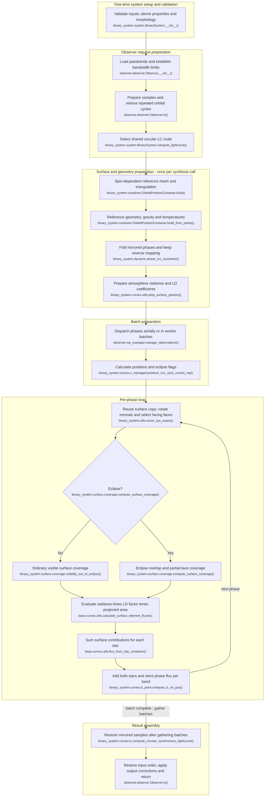

# Circular asynchronous unspotted binary light-curve flow

This describes the **current `feature/optimizations` working-tree code path**
(HEAD `7439cf6f` at tracing time) for a circular binary (`eccentricity == 0`)
with at least one component having `synchronicity != 1`, no spots and no
pulsations, using ordinary light-curve surface/flux synthesis. Spotted,
eccentric and pulsating systems, RV, fitting and MCMC wrappers are excluded.

## Execution flow

**This configuration uses the implementation named
`compute_circular_synchronous_lightcurve()`.** In
`binary_system.curves.c_router.resolve_curve_method()`, asynchronous rotation
alone does not select a different implementation: for the stated inputs the
circular branch reaches `fn_array[0]`. The execution and reuse boundaries are
the same as in the synchronous document; the actual spin-dependent reference
surface values need not be the same.

Module names below are relative to `elisa`. Initialization determines morphology
from component surface and critical potentials. In this asynchronous case,
`BinarySystem.compute_morphology()` can classify detached, semi-detached or
double-contact configurations; inconsistent potentials raise an error. No
particular morphology is assumed by the LC route.

The preparation nodes group nested work: `OrbitalPositionContainer.build()`
builds mesh points, then `build_from_points()` starts with triangulation and
continues through geometry, gravity and temperatures. The reference separation
is 1 in semi-major-axis units. Both coverage branches finish area assembly and
scaling inside `compute_surface_coverage()` before flux evaluation. Flux nodes
show calculation order inside nested calls, not additional phase sweeps.

## Reuse and repeated work

- **Once at construction:** input validation and unit conversion, mass ratio,
  semi-major axis, orbit, critical potentials, morphology, radii and surface
  defaults. The observer loads passbands and bandwidth limits.
- **Once per synthesis call:** build the reference mesh, face connectivity,
  centres, normals, areas, gravity and temperature distribution. Synchronicity
  is retained in component containers and used by the potential/mesh and
  gravity calculations; asynchronous rotation is not replaced by unity.
  Atmosphere normal radiance and LD coefficients are evaluated and stored
  before worker dispatch. Another synthesis call repeats reference preparation.
- **Same reuse boundary as synchronous synthesis:** the selected worker copies
  this equilibrium surface for each evaluated phase. It does not regenerate
  mesh points or faces, recompute intrinsic normals/areas or gravity, or rebuild
  temperatures. Observer-frame points, face centres and normals are rotated
  on the copy; sight cosines and facing-face indices are recalculated. Thus
  reusing intrinsic geometry does not mean normals stay fixed in observer
  coordinates. No phase-dependent surface rebuild is selected merely by a
  non-unit synchronicity in this configuration.
- **Same phase reductions:** `Observer.phase_interval_reduce()` applies
  modulo 1, rounds to nine decimals and deduplicates. Its bypass condition is
  false for the stated configuration. `dynamic.phase_crv_symmetry()` then maps
  phases above 0.5 to `1 - phase`, rounds those counterparts to nine decimals
  and deduplicates. This helper does not require unit synchronicity. Reverse
  maps restore mirrored samples and then original input sampling/order.
- **Radiative reuse:** normal radiance is evaluated on symmetry faces and
  mirrored back; LD preparation uses surface symmetry with the configured
  single-coefficient option or supplied coefficients handled as implemented.
  Tabulated LD interpolation uses
  `base.curves.utils.interpolate_on_ld_grid_cached()` when needed. The phase
  loop reuses the resulting radiance and coefficient arrays, but evaluates
  the angle-dependent LD factor again using that phase's sight cosines.
- **Per batch:** compute orbital positions, eclipse boundaries and eclipse
  flags. **Per evaluated phase:** copy/orient the reference, determine visible
  coverage (including eclipse overlap), evaluate surface contributions and
  sum flux. Batch results are gathered before reconstruction and observer
  output corrections. There is no additional asynchronous surface-update loop.

## Code-trace notes

Paths are relative to `src/elisa/`. Short helper names in a row belong to the
stated module/class unless explicitly qualified.

| Conceptual step                               | Main function(s)                                                                                                                                                                   | Notes                                                                                                                                                                                                                                                                                                                                       |
|-----------------------------------------------|------------------------------------------------------------------------------------------------------------------------------------------------------------------------------------|---------------------------------------------------------------------------------------------------------------------------------------------------------------------------------------------------------------------------------------------------------------------------------------------------------------------------------------------|
| Initialise and classify                       | `binary_system.system.BinarySystem.__init__()`, `BinarySystem.compute_morphology()`                                                                                                | Validates/transforms inputs and derives binary properties. With a non-unit synchronicity, morphology uses comparisons to each component's critical surface potential; it is not inferred to be detached.                                                                                                                                    |
| Prepare observer/request                      | `observer.observer.Observer.__init__()`, `Observer.lc()`, `Observer.manage_time_series()`, `Observer.phase_interval_reduce()`                                                      | Load passbands; validate time/phase request, convert times using epoch/period if needed, subtract phase shift and deduplicate periodic samples. Pass bands, bandwidths, phases and position callback to binary.                                                                                                                             |
| Select shared implementation                  | `binary_system.system.BinarySystem.compute_lightcurve()`, `binary_system.curves.c_router.resolve_curve_method()`                                                                   | Circular branch selects `BinarySystem._compute_circular_synchronous_lightcurve()`, delegating to `binary_system.curves.lc.compute_circular_synchronous_lightcurve()`. There is no separate asynchronous-unspotted implementation on this path.                                                                                              |
| Build reference surface                       | `binary_system.curves.c_router.prep_initial_system()`, `binary_system.container.OrbitalPositionContainer.from_binary_system()`, `OrbitalPositionContainer.build()`                 | Copies actual component parameters and assigns radii at distance 1. `build_mesh()` creates points; `build_from_points()` constructs faces and surface physics before flattening.                                                                                                                                                            |
| Include component spin in equilibrium physics | `binary_system.model.pre_calculate_for_potential_value_primary()`, `pre_calculate_for_potential_value_secondary()`, `binary_system.surface.gravity.calculate_potential_gradient()` | Potential coefficients and gravity include synchronicity squared. These feed the reference preparation; sharing the synthesis route does not imply identical geometry or flux to a unit-spin model.                                                                                                                                         |
| Prepare geometry and temperatures             | `binary_system.container.OrbitalPositionContainer.build_from_points()`, `build_faces_and_kinematic_quantities()`, `build_temperature_distribution()`                               | Builds faces, gravity, orientation, corrected mesh, areas and temperature distribution once per synthesis call. Per-phase rotation changes vector coordinates, not the equilibrium surface solution.                                                                                                                                        |
| Reduce mirror samples                         | `binary_system.dynamic.phase_crv_symmetry()`                                                                                                                                       | After reference build and before radiative preparation. Absence of spots and pulsations enables the symmetry reduction, with no synchronicity check.                                                                                                                                                                                        |
| Prepare atmosphere and LD                     | `binary_system.curves.c_router.produce_circular_sync_curves()`, `binary_system.curves.utils.prep_surface_params()`                                                                 | Calls `get_limbdarkening_cfs()` and `_get_normal_radiance()`. `atm.atm.NaiveInterpolatedAtm.radiance()` uses temperature, log gravity, metallicity, atmosphere and passbands; `atm.atm.correct_normal_radiance_to_optical_depth()` corrects radiance using LD coefficients. Stores both arrays on the reference containers before dispatch. |
| Batch processing                              | `observer.mp_manager.manage_observations()`, `binary_system.curves.c_managed.produce_circ_sync_curves_mp()`                                                                        | Serial or multiprocessing according to settings/sample count. Callback `binary_system.system.BinarySystem.calculate_orbital_motion()` computes positions; `binary_system.dynamic.get_eclipse_boundaries()` and `in_eclipse_test()` compute batch eclipse flags.                                                                             |
| Orient copied surface                         | `binary_system.utils.move_sys_onpos()`, `base.container.PositionContainer.apply_rotation()`                                                                                        | Worker passes `on_copy=True`; updates position, flattens, rotates points/normals/face centres, calculates face angles and applies dark-side filter. No surface rebuilding is called in this loop.                                                                                                                                           |
| Visibility and eclipse coverage               | `binary_system.surface.coverage.compute_surface_coverage()`, `visibility_out_of_eclipse()`                                                                                         | Select foreground/background by azimuth. No eclipse: facing-face areas. Eclipse: projected outline, overlap classification and partial-face uncovered areas. Both branches assemble coverage and scale by semi-major axis squared. Coverage is surface area, not a dimensionless fraction.                                                  |
| Phase flux integration                        | `base.curves.utils.calculate_surface_element_fluxes()`, `flux_from_star_container()`, `binary_system.curves.lc_point._calculate_lc_point()`, `compute_lc_on_pos()`                 | For facing faces: normal radiance × angle-dependent LD factor × sight cosine × coverage. Sum faces per star, then both stars; store a value for each passband at each evaluated phase. No exposure-time integration is performed here.                                                                                                      |
| Reconstruct output                            | `binary_system.curves.lc.compute_circular_synchronous_lightcurve()`, `observer.observer.Observer.lc()`                                                                             | Gather batches, restore mirrored samples then original periodic sampling. Add constant additional light from the mean restored band curve; return phase-shift-restored phases with maximum-normalised flux, or distance-adjusted flux and optional magnitudes. Store output on observer.                                                    |

The naming of the shared implementation is broader in actual routing than its
name suggests. No control-flow ambiguity was found for these inputs; numerical
atmosphere/LD data, LD law, coverage backend and process count remain configurable.
