# Circular synchronous pulsating binary light-curve flow

This traces the current `feature/optimizations` working tree for ordinary binary
LC synthesis with circular orbit, both synchronicities equal to 1, at least one
component with nonradial pulsation modes, and no spots. Eclipses are included.
RV, fitting, MCMC, spotted and eccentric configurations are excluded. Morphology
is determined during initialization; the LC route does not require detached
morphology. Perturbations below use the current Cartesian implementation.

## Execution flow

Names are relative to `elisa`. Pulsations select
`compute_circular_pulsating_lightcurve()` instead of the nonpulsating circular
route. The reference build explicitly uses `build_pulsations=False`; the worker
copies that equilibrium for every phase, then applies a complete pulsation
snapshot before preparing radiative arrays and observer-facing geometry.

```mermaid
flowchart TD
    subgraph setup[System and mode initialization]
        A["Validate modes and derive angular frequencies<br/><small>pulse.mode.PulsationMode.__init__()</small>"]
        B["Initialise binary, morphology and mode amplitudes<br/><small>binary_system.system.BinarySystem.__init__()</small>"]
        C["Attach system and load passbands<br/><small>observer.observer.Observer.__init__()</small>"]
    end
    subgraph prep[Once per synthesis request]
        D["Prepare unwrapped phases and select pulsating LC<br/><small>observer.observer.Observer.lc()</small>"]
        E["Build equilibrium mesh and physics without perturbations<br/><small>binary_system.curves.c_router.prep_initial_system()</small>"]
        F["Dispatch phases serially or in batches<br/><small>observer.mp_manager.manage_observations()</small>"]
    end
    subgraph batch[Once per batch]
        G["Calculate orbital positions and eclipse flags<br/><small>binary_system.curves.c_managed.produce_circ_pulsating_curves_mp()</small>"]
    end
    subgraph phase[Per phase - fresh equilibrium copy and pulsations]
        H["Copy equilibrium; set position and elapsed time<br/><small>binary_system.curves.c_managed.produce_circ_pulsating_curves_mp()</small>"]
        I["Evaluate time-dependent harmonics and Cartesian gradients<br/><small>pulse.container_ops.generate_harmonics()</small>"]
        J["Construct each mode's complex Cartesian displacement<br/><small>pulse.container_ops.complex_displacement()</small>"]
        K["Add summed real displacements to equilibrium vertices<br/><small>pulse.container_ops.position_perturbation()</small>"]
        L["Add intrinsic pulsational velocity to face velocity<br/><small>pulse.container_ops.velocity_perturbation()</small>"]
        M["Use acceleration to perturb effective log gravity<br/><small>pulse.container_ops.gravity_acc_perturbation()</small>"]
        N["Apply summed thermal factors to equilibrium temperatures<br/><small>pulse.container_ops.temp_perturbation()</small>"]
        O["Recompute centres, normals and areas; retain faces<br/><small>pulse.container_ops.incorporate_pulsations_to_model()</small>"]
        P["Recalculate atmosphere radiance and LD coefficients<br/><small>binary_system.curves.utils.prep_surface_params()</small>"]
        Q["Orient perturbed surface and select facing faces<br/><small>binary_system.utils.move_sys_onpos()</small>"]
    end
    subgraph flux[Visibility and phase flux integration]
        R{"Eclipse?<br/><small>binary_system.surface.coverage.compute_surface_coverage()</small>"}
        S["Use ordinary facing-face areas<br/><small>binary_system.surface.coverage.visibility_out_of_eclipse()</small>"]
        T["Resolve overlap and partial-face uncovered areas<br/><small>binary_system.surface.coverage.compute_surface_coverage()</small>"]
        U["Evaluate radiance times LD times projected uncovered area<br/><small>base.curves.utils.calculate_surface_element_fluxes()</small>"]
        V["Sum faces and both stars into each band flux<br/><small>binary_system.curves.lc_point.compute_lc_on_pos()</small>"]
    end
    subgraph results[Result assembly]
        W["Gather batch flux arrays in input order<br/><small>observer.mp_manager.manage_observations()</small>"]
        X["Restore phase shift and apply output corrections<br/><small>observer.observer.Observer.lc()</small>"]
    end
    A --> B --> C --> D --> E --> F --> G --> H --> I --> J --> K --> L --> M --> N --> O --> P --> Q --> R
    R -->|No| S --> U
    R -->|Yes| T --> U
    U --> V
    V -->|next phase - fresh equilibrium copy| H
    V -->|batch complete| W --> X
```

I–O are nested operations inside `OrbitalPositionContainer.build_pulsations()`:
`build_harmonics()` calls the binary pulsation wrapper, then
`build_perturbations()` calls incorporation on each pulsating component. A clean
companion skips perturbations. The chart expands this single sequence to show
which quantities actually change. Coverage branches finish area assembly and
scaling before U. U and V show calculation order within nested flux calls.

## Reuse and repeated work

Compared with [circular synchronous unspotted synthesis](BINARY_LC_FLOW_CIRCULAR_SYNCHRONOUS_UNSPOTTED.md),
the fixed equilibrium surface is reused as a starting snapshot, not as the
final surface for every phase. Pulsations add temporal evaluation, displaced
geometry, effective-gravity/thermal perturbations and fresh radiative synthesis.

- **Once per system:** validate mode inputs and derive `angular_frequency` and
  analytic harmonic normalization in `PulsationMode`. Binary initialization
  derives morphology, equilibrium radii and physical properties and calls
  `assign_pulsations_amplitudes()` with the semi-major axis as mesh-to-metre
  scale. `pulse.pulsations.assign_amplitudes()` derives radial/horizontal
  displacement scales from `amplitude/angular_frequency` and the configured or
  derived horizontal/radial ratio. `amplitude` is a velocity coefficient scale,
  not generally an RMS velocity. Thermal coefficient
  `temperature_amplitude_factor` is supplied or derived from the mode and
  physical equivalent radius; it is not recomputed from each displaced mesh.
- **Once per request:** build a flattened equilibrium mesh at separation 1,
  including face connectivity, equilibrium normals, areas, gravity, velocities
  and temperature distribution (with configured reflection). No perturbations
  or time-dependent harmonics are incorporated into this reference. The
  geometry builders still follow the classified morphology.
- **Timing and cycles:** `Observer.manage_time_series()` converts times using
  epoch/period and subtracts phase shift. `phase_interval_reduce()` returns
  pulsating requests unchanged with identity indices: no modulo-one folding,
  rounding or sample deduplication. The pulsating LC route also omits circular
  mirror-phase folding. Orbital positions retain unwrapped phase, and
  `OrbitalPositionContainer.set_time()` sets `time = 86400*period*phase` seconds.
  The binary harmonic wrapper subtracts the component emission-time delay
  `(star.com[0] - pos_correction)*semi_major_axis/C` before harmonic evaluation.
  Thus equal orbital orientation in later cycles need not mean equal pulsation.
- **Per batch:** calculate orbital motion, eclipse boundaries and eclipse flags.
  **Per phase:** copy the equilibrium container and set position/time; generate
  harmonics and their Cartesian tangent gradients on equilibrium directions.
  Each mode includes `exp(-i*(angular_frequency*time + start_phase))` using the
  emission-corrected time. Mode 0 supplies the shared axis/locking convention;
  synchronous rotation gives zero rotational drift correction here, without
  suppressing temporal oscillation. Harmonics are regenerated each phase,
  rather than reused as time-independent arrays across the worker loop.
- **Cartesian displacement:** construct each mode's radial and tangential
  displacement in the shared mode frame and rotate it into component Cartesian
  axes. Physical amplitudes are divided by semi-major axis to enter normalized
  mesh units. Harmonics use analytic full-sphere normalization; the horizontal
  term additionally uses the discrete mesh RMS of `radius * gradient` at this
  snapshot. Add the real vector sum over modes to frozen component-relative
  equilibrium vertices, then restore the component centre. This intrinsic
  displacement is distinct from later orbital/observer-frame rotation and COM
  positioning. No finite spherical-coordinate increments are applied.
- **Velocity and acceleration really run in LC:** incorporation calls both
  perturbation functions unconditionally for a pulsating component. Intrinsic
  derivatives use frozen mode orientation: velocity is the sum of first
  harmonic derivatives, face-averaged and added to equilibrium velocity.
  Acceleration is the sum of second derivatives, face-averaged and added to
  the inward equilibrium effective-gravity vector; `log_g` becomes the log
  magnitude of that vector. This uses **equilibrium normals**, before their
  geometric replacement. LC flux does not directly integrate velocity, but
  the shared incorporation still computes it. There is no new equipotential
  or gravitational-potential solve on the displaced mesh.
- **Thermal perturbations:** for each mode, evaluate
  `beta * Re[exp(-i*thermal_phase_shift) * point_harmonics]`, where `beta` is
  `temperature_amplitude_factor`. Sum these dimensionless factors, average
  them over each face and multiply by its existing equilibrium temperature;
  add that increment once. This uses the scalar harmonic, not a Cartesian
  displacement coordinate. A fresh equilibrium copy restores temperatures,
  log gravity and velocities before every phase, so updates do not accumulate
  between snapshots. Equilibrium reflection is not solved again after displacement.
- **Geometry after perturbations:** retain equilibrium face connectivity and
  recalculate face centres, normals and areas from displaced vertices, after
  kinematic/gravity/temperature updates. A nonpulsating companion retains its
  equilibrium geometry and physics. There is no full mesh generation or
  retriangulation inside the pulsating worker loop.
- **Radiance/LD and symmetry:** `prep_surface_params()` runs for both components
  every phase, using current temperatures and effective log gravity. It includes
  normal radiance, LD coefficients and optical-depth correction; the worker
  has no radiative-array reuse branch, even for a clean companion. Internal LD
  interpolation caching may still apply. Pulsating components cannot use the
  unperturbed surface symmetry shortcut; a clean companion retains its own
  geometry/gravity and normal-radiance symmetry where tested per component.
  LD preparation and equilibrium reflection's quarter-star test use the
  system-wide absence of pulsations, so those shortcuts are disabled here.
- **Visibility and flux:** after radiative preparation, rotate the perturbed
  points/normals/centres, recompute sight cosines and facing-face indices, then
  calculate coverage using the batch eclipse flag. Coverage uses displaced
  triangle geometry and areas; no-eclipse faces use current visible areas.
  Eclipse flags themselves come from the binary reference eclipse-boundary
  calculation, not a fresh event search on the displaced surface. Sum normal
  radiance × angular LD factor × sight cosine × uncovered area over faces
  and both stars. Output retains input sampling with additional-light,
  phase-shift, normalization/distance and optional magnitude handling.

## Code-trace notes

Names are relative to `elisa`; short helpers belong to the stated module/class.

| Conceptual step                     | Main function(s)                                                                                                                                                                                                                      | Notes                                                                                                                                                                                                          |
|-------------------------------------|---------------------------------------------------------------------------------------------------------------------------------------------------------------------------------------------------------------------------------------|----------------------------------------------------------------------------------------------------------------------------------------------------------------------------------------------------------------|
| Mode and binary setup               | `pulse.mode.PulsationMode.__init__()`, `binary_system.system.BinarySystem.__init__()`, `base.system.System.assign_pulsations_amplitudes()`, `pulse.pulsations.assign_amplitudes()`                                                    | Mode validation, frequency/normalization state, binary morphology and physical displacement/thermal scales.                                                                                                    |
| Request and routing                 | `observer.observer.Observer.lc()`, `Observer.manage_time_series()`, `Observer.phase_interval_reduce()`, `binary_system.curves.c_router.resolve_curve_method()`                                                                        | Circular system with pulsations and no asynchronous spotted component selects `BinarySystem._compute_circular_pulsating_lightcurve()`, then `binary_system.curves.lc.compute_circular_pulsating_lightcurve()`. |
| Equilibrium reference               | `binary_system.curves.c_router.prep_initial_system()`, `binary_system.container.OrbitalPositionContainer.build()`                                                                                                                     | Called with `build_pulsations=False`; retains complete flattened equilibrium state at unit separation.                                                                                                         |
| Dispatch and batch                  | `binary_system.curves.c_router.produce_circular_pulsating_curves()`, `observer.mp_manager.manage_observations()`, `binary_system.curves.c_managed.produce_circ_pulsating_curves_mp()`                                                 | Position callback `binary_system.system.BinarySystem.calculate_orbital_motion()` preserves phase. Batch eclipse flags use `binary_system.dynamic.get_eclipse_boundaries()` / `in_eclipse_test()`.              |
| Snapshot time and pulsations        | `binary_system.container.OrbitalPositionContainer.set_on_position_params()`, `set_time()`, `build_pulsations()`                                                                                                                       | Fresh equilibrium copy per phase; harmonic preparation followed by perturbation incorporation.                                                                                                                 |
| Harmonics and emission time         | `binary_system.surface.pulsations.build_harmonics()`, `pulse.container_ops.generate_harmonics()`, `pulse.utils.generate_time_exponential()`                                                                                           | Binary wrapper supplies corrected emission time and component-relative origin; all modes use shared mode-0 axes but individual frequencies/start phases.                                                       |
| Cartesian multimode motion          | `pulse.container_ops.complex_displacement()`, `position_perturbation()`, `velocity_perturbation()`, `gravity_acc_perturbation()`                                                                                                      | Sum mode vectors/derivatives; update positions, velocities and effective log gravity from the equilibrium snapshot.                                                                                            |
| Thermal update                      | `pulse.container_ops.temp_perturbation()`, `pulse.surface.kinematics.calculate_temperature_pert_factor()`                                                                                                                             | Sum mode scalar thermal factors and average onto faces, then scale by local equilibrium temperature.                                                                                                           |
| Rebuild displaced face geometry     | `pulse.container_ops.incorporate_pulsations_to_model()`                                                                                                                                                                               | After all perturbations, sets centres, normals and areas with retained face connectivity. Called through `binary_system.surface.pulsations.build_perturbations()`.                                             |
| Radiative synthesis and orientation | `binary_system.curves.utils.prep_surface_params()`, `binary_system.utils.move_sys_onpos()`                                                                                                                                            | Recompute radiative arrays first, then orient the same perturbed container with `on_copy=False`, `recalculate_velocities=False`; already computed pulsational velocity is retained.                            |
| Coverage and integrated flux        | `binary_system.surface.coverage.compute_surface_coverage()`, `visibility_out_of_eclipse()`, `base.curves.utils.calculate_surface_element_fluxes()`, `flux_from_star_container()`, `binary_system.curves.lc_point.compute_lc_on_pos()` | Eclipse/no-eclipse branches both lead to integration of current surface radiance and uncovered projected area. Surface integration at sampled phases, not exposure-time averaging.                             |
| Assemble output                     | `observer.mp_manager.manage_observations()`, `observer.observer.Observer.lc()`                                                                                                                                                        | Gather batches, preserve samples through identity map, apply additional light/output corrections and return phases plus band curves.                                                                           |
