# Circular synchronous spotted binary light-curve flow

This maps the current `feature/optimizations` working-tree implementation for
ordinary binary LC synthesis with `eccentricity == 0`, both synchronicities
equal to 1, at least one spot and no pulsations. Eclipses are included. RV,
fitting, MCMC, asynchronous, eccentric and pulsating configurations are excluded.
Morphology is determined during initialization; it is not assumed detached.

## Execution flow

Names are relative to `elisa`. Synchronous spots still select
`compute_circular_synchronous_lightcurve()`: the circular router's alternative
spot route requires non-unit synchronicity on a spotted component. Here the
reference surface includes spots and is fixed in the orbital frame. Each phase
changes its observer orientation and coverage, not its intrinsic spot pattern.

```mermaid
flowchart TD
  subgraph setup[One-time initialization]
    A["Validate binary properties and determine morphology<br/><small>binary_system.system.BinarySystem.__init__()</small>"]
    B["Attach system and load passbands<br/><small>observer.observer.Observer.__init__()</small>"]
  end
  subgraph request[Observer request preparation]
    C["Prepare samples and deduplicate orbital cycles<br/><small>observer.observer.Observer.lc()</small>"]
    D["Select shared circular synchronous route<br/><small>binary_system.curves.c_router.resolve_curve_method()</small>"]
  end
  subgraph surface[Reference preparation - once per synthesis call]
    E["Create reference container at unit separation<br/><small>binary_system.curves.c_router.prep_initial_system()</small>"]
    F["Build morphology-dependent stellar mesh<br/><small>binary_system.surface.mesh.build_mesh()</small>"]
    G["Generate spot centres, boundaries and surface points<br/><small>binary_system.surface.mesh.mesh_spots()</small>"]
    H["Incorporate spot points and remove overlaps<br/><small>base.spot.incorporate_spots_mesh()</small>"]
    I["Triangulate merged surface and assign spot faces<br/><small>binary_system.surface.faces.build_surface_with_spots()</small>"]
    J["Compute geometry, gravity and spot temperatures<br/><small>binary_system.container.OrbitalPositionContainer.build_from_points()</small>"]
    K["Flatten stellar and spot arrays into one surface<br/><small>base.container.StarContainer.flat_it()</small>"]
    L["Retain full phase range; no mirror folding<br/><small>binary_system.dynamic.phase_crv_symmetry()</small>"]
    M["Prepare normal radiance and LD for all faces<br/><small>binary_system.curves.utils.prep_surface_params()</small>"]
  end
  subgraph batch[Batch preparation]
    N["Dispatch serially or in phase batches<br/><small>observer.mp_manager.manage_observations()</small>"]
    O["Compute orbital positions and eclipse flags<br/><small>binary_system.curves.c_managed.produce_circ_sync_curves_mp()</small>"]
  end
  subgraph loop[Per evaluated phase - reuse prepared spotted surface]
    P["Copy and rotate surface; select facing faces<br/><small>binary_system.utils.move_sys_onpos()</small>"]
    Q{"Eclipse?<br/><small>binary_system.surface.coverage.compute_surface_coverage()</small>"}
    R["Use ordinary visible surface areas<br/><small>binary_system.surface.coverage.visibility_out_of_eclipse()</small>"]
    S["Resolve overlap and partial-face uncovered areas<br/><small>binary_system.surface.coverage.compute_surface_coverage()</small>"]
    T["Evaluate ordinary and spot face contributions<br/><small>base.curves.utils.calculate_surface_element_fluxes()</small>"]
    U["Sum faces and both stars into band flux<br/><small>binary_system.curves.lc_point.compute_lc_on_pos()</small>"]
  end
  subgraph results[Result assembly]
    V["Gather batches and apply identity phase map<br/><small>binary_system.curves.lc.compute_circular_synchronous_lightcurve()</small>"]
    W["Restore requested samples and apply output corrections<br/><small>observer.observer.Observer.lc()</small>"]
  end
  A --> B --> C --> D --> E --> F --> G --> H --> I --> J --> K --> L --> M
  M --> N --> O --> P --> Q
  Q -->|No| R --> T
  Q -->|Yes| S --> T
  T --> U
  U -->|next phase| P
  U -->|batch complete| V --> W
```

Reference nodes group work inside `OrbitalPositionContainer.build()`:
`build_mesh()` includes spot incorporation; `build_from_points()` begins with
face construction and then completes surface physics. I highlights the spotted
component's triangulation within that call, rather than a separate second
triangulation. A component without spots retains its unspotted face builder.
Both coverage branches finish coverage assembly and area scaling before T.
`compute_lc_on_pos()` calls `_calculate_lc_point()`, which sums each star via
`flux_from_star_container()`; that helper sums the face contributions in T.

## Reuse and repeated work

- **Once per system:** component/spot definitions and input validation, binary
  orbit, semi-major axis, critical potentials, morphology, radii and mesh
  defaults. For this circular unit-spin case, morphology uses the existing
  filling-factor logic. The observer loads passbands and wavelength limits.
- **Once per synthesis request:** create a reference container at distance 1
  in semi-major-axis units. Build the stellar mesh; generate spot centres and
  boundary/interior points from longitude, latitude, angular radius and mesh
  sampling; remove overlapping underlying points and incorporate spot meshes.
  Triangulate combined points and assign faces to star/spot subsets. Spots
  occupy the stellar equipotential surface; their temperature factor does not
  impose a separate raised surface or a separate gravity law.
- **Surface physics before the phase loop:** compute gravity for ordinary and
  spot faces from the potential gradient; determine normals and areas from
  the mesh. Spot temperatures are the gravity-dependent effective temperatures
  multiplied by each spot's `temperature_factor`. Renormalise stellar and spot
  temperatures together to preserve the component's bolometric effective
  temperature, then apply reflection if enabled with positive iteration count.
  Flatten ordinary and spot points, faces, normals, centres, areas, log gravity
  and temperatures into unified component arrays.
- **Radiative reuse:** atmosphere normal radiance and LD coefficients are
  prepared once from those arrays, including optical-depth correction, and
  stored before dispatch. Spotted faces use their own temperatures and log
  gravity with their parent component's atmosphere and metallicity. The phase
  loop reuses these arrays; only the angle-dependent LD factor is evaluated
  again. Tabulated LD interpolation may use
  `base.curves.utils.interpolate_on_ld_grid_cached()`; this is separate from
  reusing already prepared arrays across phases. Supplied LD coefficients
  retain their configured handling.
- **Symmetry compared with the unspotted case:** modulo-one reduction, rounding
  to nine decimals and deduplication in `Observer.phase_interval_reduce()`
  remain active. `dynamic.phase_crv_symmetry()` returns unchanged phases and
  an identity map while spots remain present, so no `1 - phase` folding occurs.
  Stellar base point generation still starts from morphology-dependent
  symmetric geometry. Spotted components use merged-surface triangulation
  rather than quarter-surface triangulation. Gravity symmetry is disabled on
  spotted components; the reflection quarter-star shortcut and LD preparation's
  system-wide symmetry test are disabled when any spot is present. Normal
  radiance symmetry is tested per component, so a clean companion can retain
  its symmetry shortcut. No symmetry is inferred for the spotted pattern.
- **Per batch:** calculate orbital positions, eclipse boundaries and flags.
  **Per phase:** copy and rotate the unified reference surface, including its
  spot faces and normals, calculate sight cosines and facing-face indices,
  resolve eclipse coverage and sum flux. Spot longitudes do not drift relative
  to the reference surface here; observer orientation changes with orbital
  phase. There is no per-phase mesh/temperature/radiance rebuild. The reference
  preparation is repeated on another synthesis call, not cached as permanent
  observer geometry.
- **Visibility and integration:** spot faces participate in the same flattened
  coverage calculation as ordinary faces, including partial-face eclipse
  intersections. Uncovered surface area is scaled by semi-major axis squared;
  each selected face contributes normal radiance × LD factor × sight cosine ×
  uncovered area. Summation includes both face types without a separate
  additive spot flux or a second subtraction of the replaced stellar area.

These symmetry statements follow the actual prepared container. Mesh overlap
handling can remove fully covered spot definitions; the symmetry helpers inspect
whether spots remain rather than merely whether the original input listed one.

## Code-trace notes

Paths are relative to `src/elisa/`; short helper names belong to the stated
module/class unless qualified separately.

| Conceptual step | Main function(s) | Notes |
|---|---|---|
| Initialise and classify | `binary_system.system.BinarySystem.__init__()`, `BinarySystem.compute_morphology()` | Validates inputs and derives properties; morphology controls surface builders, not the choice of this LC route. |
| Prepare observer samples | `observer.observer.Observer.lc()`, `Observer.manage_time_series()`, `Observer.phase_interval_reduce()` | Converts times if supplied, subtracts phase shift, rounds/deduplicates modulo-one phases. Synchronous spots do not trigger the reduction bypass. |
| Select synthesis | `binary_system.system.BinarySystem.compute_lightcurve()`, `binary_system.curves.c_router.resolve_curve_method()` | Calls `BinarySystem._compute_circular_synchronous_lightcurve()`, then `binary_system.curves.lc.compute_circular_synchronous_lightcurve()`. Spots alone do not select a different worker. |
| Reference construction | `binary_system.curves.c_router.prep_initial_system()`, `binary_system.container.OrbitalPositionContainer.build()` | Creates reference at unit separation; builds mesh, surface physics and flattened representation before phase evaluation. |
| Spot geometry and incorporation | `binary_system.surface.mesh.build_mesh()`, `add_spots_to_mesh()`, `mesh_spots()`, `base.spot.incorporate_spots_mesh()` | Morphology-dependent clean mesh followed by spot point/boundary generation and overlap removal. Local spot coordinates are fixed for this configuration. |
| Triangulate and partition | `binary_system.surface.faces.build_faces()`, `build_surface_with_spots()` | Spotted components triangulate merged points using morphology-specific builder and split faces into component/spot subsets. Clean components use their unspotted builder. |
| Geometry and gravity | `binary_system.container.OrbitalPositionContainer.build_from_points()`, `binary_system.surface.gravity.build_surface_gravity()` | Builds face geometry, orientation and areas; evaluates spot gravity from the same component potential gradient at spot points. Temperature contrast affects radiance through temperature, not an imposed gravity offset. |
| Temperature distribution | `binary_system.surface.temperature.build_temperature_distribution()`, `apply_reflection_effect()`, `base.surface.temperature.renormalize_temperatures()` | Gravity-dependent temperatures, spot factors, global renormalisation and configured reflection. Reflection redistributes its flattened temperature results back to ordinary/spot subsets before final flattening. |
| Flatten surface | `base.container.StarContainer.flat_it()` | Combines ordinary and spot arrays, including face-index offsets, so later orientation, coverage and flux see one component surface. Flattening is guarded against repetition. |
| Phase/radiative preparation | `binary_system.dynamic.phase_crv_symmetry()`, `binary_system.curves.c_router.produce_circular_sync_curves()`, `binary_system.curves.utils.prep_surface_params()` | Identity phase mapping with spots present. Calls `get_limbdarkening_cfs()` and `_get_normal_radiance()` once before dispatch; the latter calls `atm.atm.NaiveInterpolatedAtm.radiance()`. Optical-depth correction uses `atm.atm.correct_normal_radiance_to_optical_depth()`. |
| Batch and orientation | `observer.mp_manager.manage_observations()`, `binary_system.curves.c_managed.produce_circ_sync_curves_mp()`, `binary_system.utils.move_sys_onpos()` | Serial or multiprocessing batches; position callback is `binary_system.system.BinarySystem.calculate_orbital_motion()`. `binary_system.dynamic.get_eclipse_boundaries()` / `in_eclipse_test()` supply flags. Worker orients a copy each phase. |
| Eclipse coverage | `binary_system.surface.coverage.compute_surface_coverage()`, `visibility_out_of_eclipse()` | Actual eclipse flag selects ordinary visible coverage or projected overlap and partial-face areas. Both act on flattened star/spot faces and scale area before flux integration. |
| Integrate and assemble | `base.curves.utils.calculate_surface_element_fluxes()`, `flux_from_star_container()`, `binary_system.curves.lc_point.compute_lc_on_pos()`, `observer.observer.Observer.lc()` | Sum face flux and both stars per band, gather batches, apply LC reverse map and restore observer input order. Add constant additional light based on restored-curve mean; restore phase shift; normalise or adjust for distance and optionally convert to magnitudes. |
