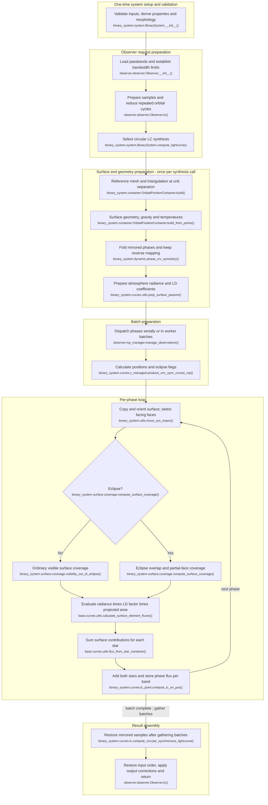

# Circular synchronous unspotted binary light-curve flow

This maps the **current working-tree code path** on `feature/optimizations`
(HEAD `7439cf6f` at tracing time) for a binary with eccentricity zero, both
synchronicities equal to one, no spots and no pulsations. It covers ordinary
surface/flux LC synthesis. Spots, pulsations, eccentricity, asynchronicity,
RV, fitting and MCMC wrappers are not covered here.

## Execution flow

Module names are relative to `elisa`. Construction occurs before observation;
reference-surface preparation occurs once per synthesis call. The loop evaluates
reduced phases, which can be fewer than the requested samples.

The mesh/triangulation and surface-physics nodes group work within `build()`:
`build_mesh()` creates points; `build_from_points()` starts with `build_faces()`
and continues through geometry, gravity and temperatures. Initialization calls
`BinarySystem.compute_morphology()` without assuming a detached system. Both
coverage branches finish area assembly/scaling before rejoining at flux evaluation.

The contribution and integration nodes show calculation order within nested
calls: `compute_lc_on_pos()` calls `_calculate_lc_point()`, which sums both
stars using `flux_from_star_container()`. That helper sums the output of
`calculate_surface_element_fluxes()`. These are not separate phase sweeps.

## Reuse and repeated work

- **Once at construction:** binary input validation and unit transformation,
  mass ratio, semi-major axis, orbit, critical potentials, morphology, component
  radii and discretisation defaults. Observer construction loads passbands.
- **Once per synthesis call:** build reference geometry at separation 1 in
  semi-major-axis units, including faces, gravity, normals, areas and temperature
  distribution. Prepare and store passband normal radiance and limb-darkening
  (LD) coefficients before dispatch. A new synthesis call repeats this work;
  this is not a persistent observer-level geometry cache.
- **Phase reuse:** the observer rounds phases modulo 1 to nine decimals and
  deduplicates them. The circular LC function additionally maps phases above
  0.5 to `1 - phase` (rounded to nine decimals) and deduplicates again. Two
  reverse maps restore sampling and original order.
- **Surface reuse:** fixed circular separation and synchronous rotation allow
  the reference surface and thermal/radiative values to be reused. Absence of
  spots and pulsations enables the explicit phase and surface symmetry paths.
  Normal radiance is evaluated on symmetry faces then mirrored. LD preparation
  uses symmetry, subject to supplied coefficients or the single-coefficient
  setting. Tabulated LD interpolation uses
  `base.curves.utils.interpolate_on_ld_grid_cached()` when coefficients are
  not supplied; reuse within the phase loop does not require a cache hit.
- **Per batch:** orbital motion, eclipse boundaries and eclipse flags are
  calculated by the worker. **Per evaluated phase:** copy and orient the
  reference container, calculate sight cosines and facing-face indices, resolve
  coverage, evaluate angle-dependent LD and sum flux. The loop does not rebuild
  the surface or re-interpolate normal radiance.

## Code-trace notes

Source modules below are under `src/elisa/`. Short helper names in a row belong
to that row's stated module unless explicitly qualified.

| Conceptual step | Main function(s) | Notes |
|---|---|---|
| Validate and initialise | `binary_system.system.BinarySystem.__init__()` | Checks required/invalid inputs and component parameters, transforms inputs, derives orbital and stellar geometry properties and defaults. This precedes LC requests. |
| Prepare observer | `observer.observer.Observer.__init__()`, `Observer.init_passband()` | Attaches the system and loads passband containers and wavelength limits. `Observables.lc()` is an optional convenience delegate to `Observer.lc()`. |
| Prepare observation request | `observer.observer.Observer.lc()`, `Observer.manage_time_series()`, `Observer.phase_interval_reduce()` | Validates time/phase input domain; converts times using epoch and period if needed, subtracts phase shift and reduces periodic samples. Passes bands, bandwidths, phases and position callback to the binary. |
| Route to this implementation | `binary_system.system.BinarySystem.compute_lightcurve()`, `binary_system.curves.c_router.resolve_curve_method()` | Chooses `BinarySystem._compute_circular_synchronous_lightcurve()`, delegating to `binary_system.curves.lc.compute_circular_synchronous_lightcurve()`. The stated assumptions select this route; the router's eligibility is broader than the scope documented here. |
| Build reference surface | `binary_system.curves.c_router.prep_initial_system()`, `binary_system.container.OrbitalPositionContainer.build()` | Creates a container from the binary at unit separation. Builds mesh then calls `build_from_points()` for faces, gravity, orientation, mesh correction, areas and temperature distribution; flattens the representation. |
| Reduce mirror phases | `binary_system.dynamic.phase_crv_symmetry()` | After reference build, before radiative preparation. Returns reduced phases and reverse indices. |
| Prepare atmosphere and LD | `binary_system.curves.c_router.produce_circular_sync_curves()`, `binary_system.curves.utils.prep_surface_params()` | The latter calls `get_limbdarkening_cfs()` and `_get_normal_radiance()`. `atm.atm.NaiveInterpolatedAtm.radiance()` uses temperatures, log gravity, metallicity, atmosphere and passbands. `atm.atm.correct_normal_radiance_to_optical_depth()` corrects radiance with LD coefficients. Both arrays are stored on reference component containers. |
| Dispatch and batch preparation | `observer.mp_manager.manage_observations()`, `binary_system.curves.c_managed.produce_circ_sync_curves_mp()` | Serial or multiprocessing batches according to settings and sample count. Calls position callback `binary_system.system.BinarySystem.calculate_orbital_motion()` and `binary_system.dynamic.get_eclipse_boundaries()` / `in_eclipse_test()`. Manager gathers worker results before reverse mapping. |
| Orient and filter | `binary_system.utils.move_sys_onpos()` | With `on_copy=True`: copies reference, sets position, flattens, rotates, calculates face angles and applies dark-side filter. Produces sight cosines and facing-face indices. |
| Visibility and coverage | `binary_system.surface.coverage.compute_surface_coverage()` | Chooses foreground/background by azimuth. During eclipse, projects outlines, classifies faces and computes uncovered portions of partial faces by polygon intersections. Outside eclipse uses facing-face areas. Coverage is uncovered surface area scaled by semi-major axis squared, not a dimensionless fraction. Projection cosine is applied later. |
| Surface contributions and phase integration | `base.curves.utils.calculate_surface_element_fluxes()`, `flux_from_star_container()`, `binary_system.curves.lc_point._calculate_lc_point()`, `compute_lc_on_pos()` | On selected faces: normal radiance × angle-dependent LD factor × sight cosine × coverage. Sum faces per star, add stars and store one value per band and phase. This integrates the surface at sampled phases, not over exposure duration. |
| Assemble output | `binary_system.curves.lc.compute_circular_synchronous_lightcurve()`, `observer.observer.Observer.lc()` | Restore mirrored samples then original periodic sampling. Add constant additional light based on the mean of each restored curve. Return phase-shift-restored phases and band arrays; normalise to maximum for dimensionless output, otherwise adjust for distance and optionally convert to magnitudes. Store results on observer. |

No control-flow ambiguity was found for the stated case. Atmosphere/LD data,
LD law, coverage intersection backend and process count depend on configuration;
this diagram does not prescribe those numerical choices.
