# Eccentric pulsating binary light-curve flow

This maps the current `feature/optimizations` working-tree implementation for
ordinary LC synthesis with `0 < eccentricity < 1`, at least one component with
nonradial pulsation modes, no spots and baseline synchronicity 1 on both
components. Eclipses are included. RV, fitting, MCMC and spotted configurations
are excluded. The current Cartesian pulsation implementation is used.

## Execution flow

**The configuration has an implemented synthesis path.** Binary/component/mode
validation does not prohibit the eccentric/pulsating combination. Eccentric
morphology uses the surface/critical-potential comparisons, allowing detached,
semi-detached or double-contact classifications and rejecting inconsistent
potentials; this LC route imposes no additional detached-only restriction.
Ordinary mode, amplitude, atmosphere and numerical-domain requirements still
apply. This conclusion is from production-code tracing, not a runtime test.

The router selects the **eccentric unspotted LC implementation**, not the
circular pulsation worker. Pulsations make approximation search ineligible;
the exact worker calls `OrbitalPositionContainer.build()` with its default
`build_pulsations=True`. That call prepares equilibrium, then actually applies
pulsations. Perturbed vertices, temperatures and effective log gravity feed
coverage and radiative flux synthesis; pulsations are not silently ignored.
Names below are relative to `elisa`.

```mermaid
flowchart TD
    subgraph setup[One-time system and mode initialization]
        A["Validate modes and derive angular frequencies<br/><small>pulse.mode.PulsationMode.__init__()</small>"]
        B["Derive binary morphology and physical mode amplitudes<br/><small>binary_system.system.BinarySystem.__init__()</small>"]
        C["Attach system and load passbands<br/><small>observer.observer.Observer.__init__()</small>"]
    end
    subgraph prep[Once per request - orbit and exact selection]
        D["Prepare unwrapped phases and select eccentric unspotted LC<br/><small>observer.observer.Observer.lc()</small>"]
        E["Calculate orbital positions and separations<br/><small>binary_system.system.BinarySystem.calculate_orbital_motion()</small>"]
        F["Correct equilibrium surface potentials at each separation<br/><small>binary_system.system.BinarySystem.correct_potentials()</small>"]
        G["Select exact evaluation; pulsations disable approximations<br/><small>binary_system.curves.c_appx_router.resolve_ecc_approximation_method()</small>"]
        H["Dispatch exact positions serially or in batches<br/><small>observer.mp_manager.manage_observations()</small>"]
    end
    subgraph batch[Once per batch]
        I["Allocate reusable container at dummy unit separation<br/><small>binary_system.container.OrbitalPositionContainer.from_binary_system()</small>"]
    end
    subgraph phase[Every phase - rebuild equilibrium then perturb]
        J["Set position, corrected potentials and elapsed time<br/><small>binary_system.curves.c_managed.integrate_eccentric_curve_exactly()</small>"]
        K["Rebuild equilibrium mesh, faces, gravity and temperatures<br/><small>binary_system.container.OrbitalPositionContainer.build()</small>"]
        L["Evaluate emission-timed harmonics and Cartesian gradients<br/><small>pulse.container_ops.generate_harmonics()</small>"]
        M["Sum Cartesian mode displacements into vertices<br/><small>pulse.container_ops.position_perturbation()</small>"]
        N["Add intrinsic pulsational face velocities<br/><small>pulse.container_ops.velocity_perturbation()</small>"]
        O["Perturb effective log gravity using acceleration<br/><small>pulse.container_ops.gravity_acc_perturbation()</small>"]
        P["Apply scalar thermal factors to equilibrium temperatures<br/><small>pulse.container_ops.temp_perturbation()</small>"]
        Q["Recompute displaced centres, normals and areas<br/><small>pulse.container_ops.incorporate_pulsations_to_model()</small>"]
        R["Copy and orient perturbed surface; select facing faces<br/><small>binary_system.utils.move_sys_onpos()</small>"]
        S["Recalculate normal radiance and LD coefficients<br/><small>binary_system.curves.utils.prep_surface_params()</small>"]
    end
    subgraph flux[Coverage and phase integration]
        T["Always process overlap and partial-face coverage<br/><small>binary_system.surface.coverage.compute_surface_coverage()</small>"]
        U["Evaluate current face radiance times LD and projected area<br/><small>base.curves.utils.calculate_surface_element_fluxes()</small>"]
        V["Sum faces and both stars into each band flux<br/><small>binary_system.curves.lc_point.compute_lc_on_pos()</small>"]
    end
    subgraph results[Result assembly]
        W["Gather exact flux arrays in request order<br/><small>observer.mp_manager.manage_observations()</small>"]
        X["Preserve samples and apply observer output corrections<br/><small>observer.observer.Observer.lc()</small>"]
    end
    A --> B --> C --> D --> E --> F --> G --> H --> I --> J --> K --> L --> M --> N --> O --> P --> Q --> R --> S --> T --> U --> V
    V -->|next phase - rebuild equilibrium| J
    V -->|batch complete| W --> X
```

K–Q group the sequence inside `build()`: reset flatten state, build mesh and
surface physics, flatten, then `build_pulsations()` calls harmonic preparation
and perturbation incorporation. Before M, `complex_displacement()` constructs
and stores each mode's complex Cartesian vectors. Perturbations are applied
only on components with modes. U/V represent nested contribution/summation
calls rather than extra phase sweeps. No eclipse decision is shown because the
exact worker always passes `in_eclipse=True`; the non-eclipse shortcut is not
reachable on this path.

## Reuse and repeated work

- **Once per system:** mode validation and angular frequencies, binary orbit,
  semi-major axis, morphology, radii and amplitude assignment. Physical radial
  and horizontal displacement scales derive from `amplitude/angular_frequency`
  and the horizontal/radial ratio, using the physical equivalent radius where
  needed. `amplitude` is a velocity coefficient scale, not generally an RMS
  velocity. The thermal coefficient `temperature_amplitude_factor` is supplied
  or derived during amplitude assignment, not fitted to each snapshot.
- **Once per request:** observer samples, orbital positions and corrected
  potentials (`iterations=2`). The orbit solves Kepler's equation, derives true
  anomaly, separation and orientation. Potential correction uses periastron as
  the reference surface and adjusts other separations using the approximate
  volume-conservation procedure. These are equilibrium potentials, not a
  gravitational-potential solution for displaced pulsating vertices.
- **No eccentric approximation:** `look_for_approximation()` requires absence
  of pulsations, so `try_to_find_appx` is false and the resolver returns exact
  mode before computing approximation radii/pairs/masks. Interpolation,
  symmetrical counterparts and similar neighbours are not eligible, regardless
  of their enable flags or sampling thresholds. There is no geometry or
  radiative reuse mask in the selected worker.
- **Once per batch:** allocate a container at dummy distance 1 and output arrays.
  **Every evaluated phase:** set current position and indexed corrected
  potentials, call `set_time()`, then rebuild both equilibrium component
  surfaces. Mesh vertices and triangulation, gravity, equilibrium velocities,
  normals, corrected areas and temperatures (including configured reflection)
  are regenerated before pulsations. The allocation is reused; the previous
  physical surface solution is not reused. There is no fixed equilibrium
  snapshot shared across separations as in circular pulsating synthesis.
- **Topology distinction:** equilibrium face connectivity is regenerated each
  phase and need not be identical across separations. Within that phase,
  Cartesian displacement retains the newly built faces; it does not retriangulate
  afterward. Incorporation then rebuilds face centres, normals and areas from
  the displaced vertices. A nonpulsating companion skips intrinsic perturbations
  but still has its equilibrium surface rebuilt and radiative arrays evaluated.
- **Timing:** `Observer.manage_time_series()` converts time inputs using epoch
  and period, then subtracts phase shift. Pulsations bypass
  `phase_interval_reduce()` with identity indices: no modulo-one folding,
  rounding, deduplication or loss of elapsed cycles. No circular mirror folding
  occurs. Orbital positions retain input phase; `set_time()` uses
  `86400*period*phase` seconds. The binary harmonic wrapper evaluates at this
  time minus `(star.com[0] - pos_correction)*semi_major_axis/C`, its emission-time
  correction. Modes use `exp(-i*(angular_frequency*time + start_phase))` with
  that corrected time. Identical orbital orientations in different cycles
  therefore remain distinct pulsation evaluations.
- **Harmonics and Cartesian motion each phase:** evaluate scalar harmonics and
  Cartesian tangent gradients on the newly built equilibrium directions. Mode 0
  supplies the shared axis and locking convention; baseline synchronicity 1
  gives zero rotational drift correction without freezing oscillation time.
  Construct each mode's radial/tangential displacement, including current
  horizontal mesh-RMS normalization of `radius * gradient`, and rotate into
  component axes. Physical displacements are divided by semi-major axis for
  normalized mesh coordinates. Add the real vector sum to component-relative
  equilibrium vertices and restore the component centre. Later orbital/observer
  rotation is distinct from this intrinsic Cartesian displacement; no finite
  spherical-coordinate perturbations are used.
- **Velocity, acceleration and thermal updates really run:** incorporation calls
  position, velocity, effective-gravity and temperature perturbations in that
  order. It sums frozen-orientation harmonic derivatives over modes, averages
  them to faces and adds velocity to the equilibrium field. Face acceleration
  modifies the inward equilibrium gravity vector using **equilibrium normals**,
  and its magnitude supplies updated `log_g`. Temperature factors are
  `beta * Re[exp(-i*thermal_phase_shift)*point_harmonics]`; sum modes, average
  factors onto faces, multiply by local equilibrium temperature and add once.
  Geometry is updated afterward. The next full equilibrium build resets these
  fields, so perturbations do not accumulate across samples. Reflection is not
  re-solved after displacement, and gravity is not recomputed from a new
  displaced equipotential. LC flux does not directly use the velocity field,
  but the common incorporation computes it nonetheless.
- **Radiance, visibility and output:** unlike the circular pulsating worker,
  the exact eccentric worker orients a copy **before** `prep_surface_params()`.
  Fresh normal radiance and LD arrays use current temperatures and effective
  log gravity, then optical-depth correction; both components are processed
  every phase. Internal data/interpolation caches do not introduce a worker
  reuse branch. Coverage always executes projected overlap/partial-face logic
  on displaced geometry with current areas. It scales uncovered area by
  semi-major axis squared; flux multiplies radiance, angular LD, sight cosine
  and area and sums faces and stars. Gather exact samples with no flux spline,
  apply observer identity mapping, additional light, restored phase shift and
  normalization/distance/optional magnitude conversion.

Compared with [eccentric unspotted synthesis](BINARY_LC_FLOW_ECCENTRIC_UNSPOTTED.md),
pulsations force its exact fallback and add perturbations inside each full
build. Compared with [circular pulsating synthesis](BINARY_LC_FLOW_CIRCULAR_SYNCHRONOUS_PULSATING.md),
equilibrium itself is rebuilt at every separation instead of copied from one
reference; radiance follows observer orientation and coverage uses no batch
no-eclipse flag. Pulsating components lose unperturbed surface symmetry shortcuts;
clean-component shortcuts inside equilibrium/radiance helpers do not imply
phase-to-phase geometry or radiative reuse.

## Code-trace notes

Names are relative to `elisa`; short helper names belong to the stated module/class.

| Conceptual step              | Main function(s)                                                                                                                                                                                                        | Notes                                                                                                                                                                        |
|------------------------------|-------------------------------------------------------------------------------------------------------------------------------------------------------------------------------------------------------------------------|------------------------------------------------------------------------------------------------------------------------------------------------------------------------------|
| Validation and mode setup    | `pulse.mode.PulsationMode.__init__()`, `binary_system.system.BinarySystem.__init__()`, `BinarySystem.compute_morphology()`, `base.system.System.assign_pulsations_amplitudes()`, `pulse.pulsations.assign_amplitudes()` | No eccentric/pulsation exclusion in these construction paths; ordinary validity and mode constraints remain.                                                                 |
| Request/routing              | `observer.observer.Observer.lc()`, `Observer.manage_time_series()`, `Observer.phase_interval_reduce()`, `binary_system.curves.c_router.resolve_curve_method()`                                                          | Preserves elapsed cycles. Eccentric, no spots selects `BinarySystem._compute_eccentric_lightcurve()` then `binary_system.curves.lc.compute_eccentric_lightcurve_no_spots()`. |
| Producer and exact selection | `binary_system.curves.c_router.produce_ecc_curves_no_spots()`, `binary_system.curves.c_appx_router.look_for_approximation()`, `resolve_ecc_approximation_method()`                                                      | Pulsations veto approximation search; exact mode is selected before approximation-specific radii/pair preparation.                                                           |
| Orbit/potentials             | `binary_system.system.BinarySystem.calculate_orbital_motion()`, `BinarySystem.correct_potentials()`, `binary_system.orbit.orbit.Orbit.orbital_motion()`                                                                 | Separation, orientation, preserved phase and approximate volume-corrected equilibrium potentials.                                                                            |
| Dispatch and exact worker    | `binary_system.curves.c_appx_router.integrate_eccentric_curve_exactly()`, `observer.mp_manager.manage_observations()`, `binary_system.curves.c_managed.integrate_eccentric_curve_exactly()`                             | Allocates container per batch; updates position/potentials/time and calls full `build()` per phase. No spots: longitude-assignment helper is a no-op.                        |
| Equilibrium plus pulsations  | `binary_system.container.OrbitalPositionContainer.build()`, `build_from_points()`, `build_pulsations()`                                                                                                                 | Full geometry/physics and flattening first; default `build_pulsations=True` then runs harmonics and perturbations.                                                           |
| Harmonics/time               | `binary_system.surface.pulsations.build_harmonics()`, `pulse.container_ops.generate_harmonics()`, `pulse.utils.generate_time_exponential()`                                                                             | Current equilibrium directions, shared mode axis, individual temporal phases and binary emission-time correction.                                                            |
| Intrinsic perturbations      | `binary_system.surface.pulsations.build_perturbations()`, `pulse.container_ops.complex_displacement()`, `position_perturbation()`, `velocity_perturbation()`, `gravity_acc_perturbation()`, `temp_perturbation()`       | Cartesian multimode displacement and derivatives; scalar thermal coefficient updates current equilibrium field.                                                              |
| Displaced face geometry      | `pulse.container_ops.incorporate_pulsations_to_model()`                                                                                                                                                                 | After perturbations, updates centres/normals/areas with this snapshot's retained face connectivity.                                                                          |
| Observer geometry/radiance   | `binary_system.utils.move_sys_onpos()`, `binary_system.curves.utils.prep_surface_params()`                                                                                                                              | Orient a copy, then calculate fresh radiative arrays; perturbed temperature/log gravity feed atmosphere and LD.                                                              |
| Coverage and flux            | `binary_system.surface.coverage.compute_surface_coverage()`, `base.curves.utils.calculate_surface_element_fluxes()`, `flux_from_star_container()`, `binary_system.curves.lc_point.compute_lc_on_pos()`                  | Forced overlap processing; current displaced geometry and radiance contribute to both-star flux.                                                                             |
| Result assembly              | `observer.mp_manager.manage_observations()`, `observer.observer.Observer.lc()`                                                                                                                                          | Gather batches and preserve samples through identity mapping; standard additional-light and output-unit handling.                                                            |
