# Eccentric spotted binary light-curve flow

This maps the current `feature/optimizations` working tree for ordinary binary
LC synthesis with `0 < eccentricity < 1`, at least one spotted component and no
pulsations. Both synchronicities are 1 in the baseline; other synchronicities
are discussed on the same route. Eclipses are included. RV, fitting, MCMC and
pulsating configurations are excluded. Morphology is initialized normally,
not assumed detached.

## Execution flow

Names are relative to `elisa`. Eccentricity plus spots selects
`compute_eccentric_spotty_lightcurve()`, independent of synchronicity. Its
producer dispatches the exact eccentric worker directly. No geometry-update
mask, angular threshold or eccentric approximation selector participates.
The only phase-reduction decision shown below depends on whether a **spotted**
component has non-unit synchronicity, not just whether any component does.

```mermaid
flowchart TD
    subgraph setup[One-time initialization]
        A["Validate binary and spots; classify morphology<br/><small>binary_system.system.BinarySystem.__init__()</small>"]
        B["Attach system and load passbands<br/><small>observer.observer.Observer.__init__()</small>"]
    end
    subgraph request[Observer preparation and routing]
        C["Convert request times or phases; subtract phase shift<br/><small>observer.observer.Observer.manage_time_series()</small>"]
        D{"Non-unit spin on a spotted component?<br/><small>observer.observer.Observer.phase_interval_reduce()</small>"}
        E["Baseline: round and deduplicate modulo-one samples<br/><small>observer.observer.Observer.phase_interval_reduce()</small>"]
        F["Preserve unwrapped phases and input indices<br/><small>observer.observer.Observer.phase_interval_reduce()</small>"]
        G["Select eccentric spotted exact synthesis<br/><small>binary_system.curves.c_router.resolve_curve_method()</small>"]
    end
    subgraph prep[Once per synthesis request]
        H["Calculate true anomaly, separation and orientation<br/><small>binary_system.system.BinarySystem.calculate_orbital_motion()</small>"]
        I["Correct volume-preserving surface potentials<br/><small>binary_system.system.BinarySystem.correct_potentials()</small>"]
        J["Calculate spot longitudes including libration<br/><small>binary_system.dynamic.calculate_spot_longitudes()</small>"]
        K["Dispatch exact positions serially or in batches<br/><small>observer.mp_manager.manage_observations()</small>"]
    end
    subgraph batch[Once per batch]
        L["Create reusable container at dummy unit separation<br/><small>binary_system.container.OrbitalPositionContainer.from_binary_system()</small>"]
    end
    subgraph phase[Every evaluated phase - full surface rebuild]
        M["Set current position, corrected potentials and time<br/><small>binary_system.curves.c_managed.integrate_eccentric_curve_exactly()</small>"]
        N["Assign this sample's spot longitudes<br/><small>binary_system.dynamic.assign_spot_longitudes()</small>"]
        O["Rebuild stellar mesh and incorporate spot boundaries/points<br/><small>binary_system.container.OrbitalPositionContainer.build_mesh()</small>"]
        P["Triangulate; rebuild geometry, gravity and temperatures<br/><small>binary_system.container.OrbitalPositionContainer.build_from_points()</small>"]
        Q["Copy and orient flattened surface; filter facing faces<br/><small>binary_system.utils.move_sys_onpos()</small>"]
        R["Recalculate atmosphere radiance and LD coefficients<br/><small>binary_system.curves.utils.prep_surface_params()</small>"]
    end
    subgraph flux[Coverage and phase flux integration]
        S["Always process overlap and partial-face coverage<br/><small>binary_system.surface.coverage.compute_surface_coverage()</small>"]
        T["Integrate ordinary and spot faces; add both stars<br/><small>binary_system.curves.lc_point.compute_lc_on_pos()</small>"]
    end
    subgraph results[Result assembly]
        U["Gather batch flux arrays without interpolation<br/><small>observer.mp_manager.manage_observations()</small>"]
        V["Restore requested samples and apply output corrections<br/><small>observer.observer.Observer.lc()</small>"]
    end
    A --> B --> C --> D
    D -->|No - baseline| E --> G
    D -->|Yes| F --> G
    G --> H --> I --> J --> K --> L --> M --> N --> O --> P --> Q --> R --> S --> T
    T -->|next evaluated phase| M
    T -->|batch complete| U --> V
```

O and P expand work inside `OrbitalPositionContainer.build()`, which resets
flatten state first and flattens the completed ordinary/spot arrays afterward.
L is a container allocation, not a fully built reference surface shared across
phases. S receives `in_eclipse=True` unconditionally from this worker; the
ordinary no-eclipse shortcut is not reachable here, even outside an actual
eclipse. Overlap processing still determines uncovered areas on the current
surface. There is no decorative eclipse decision or threshold branch to draw.

## Reuse and repeated work

- **Once per system:** input/spot validation, orbit, semi-major axis, critical
  potentials, morphology, radii and defaults. Eccentric morphology uses
  component surface/critical-potential comparisons and can classify detached,
  semi-detached or double-contact, or reject inconsistent parameters. The LC
  router does not add a morphology restriction; mesh/face builders follow the
  classified morphology in the full build.
- **Once per request:** observer sampling/reverse map, orbital positions,
  corrected potentials for both components (`iterations=2`) and longitude
  arrays for every spot. Orbital motion solves Kepler's equation, derives true
  anomaly, separation and azimuth and retains its input phase column. Potential
  correction uses the input periastron surface as its volume reference and
  adjusts potentials at other separations using the existing approximate
  volume procedure. These arrays are indexed by original evaluated-position
  indices even when positions are split into worker batches.
- **Spot timing:** `produce_ecc_curves_with_spots()` calls
  `calculate_spot_longitudes()` without overriding its default
  `correct_libration=True`. The implemented longitude is
  `initial_longitude + 2*pi*(synchronicity - 1)*phase + libration_correction`.
  `correct_spot_positions_for_libration()` evaluates orbital motion at requested
  phases plus phase zero, converts true to eccentric and then mean anomaly,
  and returns `(mean_anomaly - true_anomaly)` relative to its phase-zero value.
  Therefore baseline spin 1 removes the linear drift term, **not libration**.
  Longitudes are calculated from the binary's definitions before batch loops,
  rather than incrementally advancing the previous mesh.
- **Orbital cycles:** baseline synchronous spotted inputs are reduced modulo 1,
  rounded to nine decimals and deduplicated by `Observer.phase_interval_reduce()`.
  Identical baseline orientations in different cycles share one calculation,
  with the reverse map restoring requested samples. If a spotted component has
  non-unit synchronicity, the observer bypasses reduction and preserves elapsed
  cycles; equal orbital orientations in different cycles can then have different
  longitudes from the linear drift term. Non-unit spin only on a clean component
  does not trigger that bypass. The eccentric spotted producer performs no
  additional phase folding. Worker `set_time()` uses the phase it receives;
  baseline cycle information was already reduced by the observer, whereas the
  asynchronous-spotted case retains it.
- **Once per batch:** allocate curve arrays and a reusable orbital-position
  container at dummy distance 1. **Every evaluated phase:** set current position
  and both corrected potentials, set time, assign longitudes, then call full
  `build()` for both components. This regenerates stellar vertices, spot
  boundaries/interior points and mesh incorporation; triangulates and splits
  ordinary/spot faces; rebuilds gravity, normals, corrected areas and thermal
  fields. Mesh topology need not remain fixed. A clean companion is also rebuilt;
  there is no per-component geometry reuse branch.
- **Thermal and radiative work:** gravity-dependent temperatures include spot
  temperature factors, joint stellar/spot renormalisation and configured
  reflection. The worker orients a copy of the flattened result, then prepares
  normal radiance and LD coefficients for both components using current
  temperature/log gravity, parent-component atmosphere and metallicity, followed
  by optical-depth correction. There is no previous-array propagation branch.
  Ordinary data/interpolation caches inside helpers may still apply; they do
  not skip the worker's surface or radiative preparation calls.
- **Coverage/flux:** flattened ordinary and spot faces use the same facing-face
  selection and projected overlap/partial-face logic. Coverage is uncovered
  surface area scaled by semi-major axis squared; flux multiplies it by sight
  cosine, angular LD factor and normal radiance. Sum faces per star and both
  stars per passband. Gather results, apply observer reverse indices, additional
  light, restored phase shift and normalization/distance/magnitude handling.

Compared with [eccentric unspotted synthesis](BINARY_LC_FLOW_ECCENTRIC_UNSPOTTED.md),
this route bypasses interpolation, symmetrical counterparts and similar-neighbour
selection entirely. `MAX_NU_SEPARATION`, `MAX_D_FLUX` and their masks do not
control this worker: all evaluated surfaces and radiative arrays are rebuilt.
Compared with [circular asynchronous spotted synthesis](BINARY_LC_FLOW_CIRCULAR_ASYNCHRONOUS_SPOTTED.md),
it applies libration correction, changes separation and corrected potentials,
and does not reuse saved clean points or skip updates using
`MAX_SPOT_D_LONGITUDE`. A container allocation is reused, not its previous
physical surface solution. Surface-symmetry shortcuts on spotted components
are unavailable; clean-component shortcuts inside helpers do not introduce
phase-to-phase reuse.

## Code-trace notes

Names are relative to `elisa`; short helpers belong to the stated module/class.

| Conceptual step                | Main function(s)                                                                                                                                                                                       | Notes                                                                                                                                                                                                                                                |
|--------------------------------|--------------------------------------------------------------------------------------------------------------------------------------------------------------------------------------------------------|------------------------------------------------------------------------------------------------------------------------------------------------------------------------------------------------------------------------------------------------------|
| Initialise and classify        | `binary_system.system.BinarySystem.__init__()`, `BinarySystem.compute_morphology()`                                                                                                                    | Normal input validation, orbit and morphology handling; no detached assumption.                                                                                                                                                                      |
| Prepare sample/time domain     | `observer.observer.Observer.lc()`, `Observer.manage_time_series()`, `Observer.phase_interval_reduce()`                                                                                                 | Baseline modulo-one deduplication versus identity/unwrapped sampling when a spotted component has non-unit spin. Time inputs use epoch and period, then subtract phase shift.                                                                        |
| Select exact spotted route     | `binary_system.system.BinarySystem.compute_lightcurve()`, `binary_system.curves.c_router.resolve_curve_method()`                                                                                       | Eccentric branch with spots calls `BinarySystem._compute_eccentric_spotty_lightcurve()`, then `binary_system.curves.lc.compute_eccentric_spotty_lightcurve()` and `c_router.produce_ecc_curves_with_spots()`. Spin changes do not change this route. |
| Orbit and equipotentials       | `binary_system.system.BinarySystem.calculate_orbital_motion()`, `BinarySystem.correct_potentials()`, `binary_system.orbit.orbit.Orbit.orbital_motion()`                                                | True anomaly, separation, orientation and phase-dependent approximate volume-preserving potentials prepared before dispatch.                                                                                                                         |
| Spot motion                    | `binary_system.dynamic.calculate_spot_longitudes()`, `correct_spot_positions_for_libration()`, `assign_spot_longitudes()`                                                                              | Libration enabled by default on this producer; longitude arrays indexed by position in exact worker.                                                                                                                                                 |
| Dispatch and worker            | `observer.mp_manager.manage_observations()`, `binary_system.curves.c_managed.integrate_eccentric_curve_exactly()`                                                                                      | Direct serial or multiprocessing dispatch; bypasses eccentric approximation resolver. One allocated container per batch, full build per sample.                                                                                                      |
| Full surface construction      | `binary_system.container.OrbitalPositionContainer.build()`, `build_mesh()`, `build_from_points()`                                                                                                      | Reset flatten state, build stellar/spot mesh and surface physics, flatten unified arrays. Current separation/potentials used each phase.                                                                                                             |
| Spot boundaries and faces      | `binary_system.surface.mesh.add_spots_to_mesh()`, `mesh_spots()`, `base.spot.incorporate_spots_mesh()`, `binary_system.surface.faces.build_surface_with_spots()`                                       | Generate spot points/boundaries, remove overlaps, triangulate merged points and assign ordinary/spot face subsets; clean component uses its unspotted face builder.                                                                                  |
| Surface temperature            | `binary_system.surface.temperature.build_temperature_distribution()`, `apply_reflection_effect()`                                                                                                      | Recompute gravity-dependent temperatures, spot contrast and renormalisation, then configured reflection; not propagated from a previous phase.                                                                                                       |
| Observer geometry and radiance | `binary_system.utils.move_sys_onpos()`, `binary_system.curves.utils.prep_surface_params()`                                                                                                             | Orient a copy first; prepare fresh normal radiance/LD arrays with current thermal and gravity values.                                                                                                                                                |
| Coverage and flux              | `binary_system.surface.coverage.compute_surface_coverage()`, `base.curves.utils.calculate_surface_element_fluxes()`, `flux_from_star_container()`, `binary_system.curves.lc_point.compute_lc_on_pos()` | Forced overlap processing, partial-face areas and sum of ordinary/spot contributions from both stars. No exposure-time averaging here.                                                                                                               |
| Output reconstruction          | `observer.mp_manager.manage_observations()`, `observer.observer.Observer.lc()`                                                                                                                         | Concatenate batches in request order and reverse observer reduction; no spline interpolation or mirror-flux reconstruction. Apply standard additional-light and output-unit handling.                                                                |
