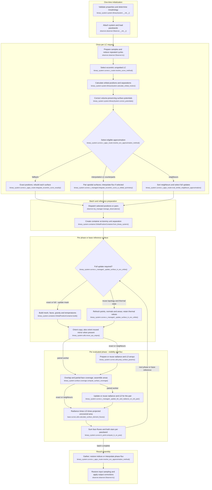

# Eccentric unspotted binary light-curve flow

This maps the current `feature/optimizations` working tree for ordinary binary
LC synthesis with `0 < eccentricity < 1`, no spots or pulsations, and baseline
component synchronicities of 1. Non-unit synchronicity does not change the
selected eccentric LC route or approximation selector; it changes the input
potentials, geometry and gravity. Spotted/pulsating systems, RV, fitting and
MCMC are excluded. No detached morphology is assumed.

## Execution flow

Names are relative to `elisa`. The selector tries interpolation, counterparts,
then neighbours; exact evaluation is the fallback. The shared worker stages
below group conditional operations rather than implying every worker performs
identical calls. In particular, the radiative node is visited **before coverage**
in exact/neighbour workers and **after coverage** in the paired worker; labelled
edges preserve that ordering using separate radiative nodes. No worker
alternates radiance and coverage within one evaluation; only the loop across
phases/base references repeats. All documented workers pass `in_eclipse=True`,
so the non-eclipse shortcut is unreachable here and omitted.

The exact worker calls `build()` directly, bypassing the update helper shown
at the full-update decision. Paired evaluation updates one base reference,
then evaluates base and available mirror with that surface; the loop-back
means the next base reference, not a new build for its mirror. In Q,
`prep_surface_params()` is the calculation entry for the exact worker; the
neighbour worker calls `update_surface_params()` to calculate or reuse arrays.
Q2 updates or reuses arrays for the base and available mirror after their
coverage calculations.
W represents the selected callable returned by the resolver, not a second
resolver invocation. Interpolation is of **computed flux**, not mesh vertices.

## Reuse and repeated work

- **Once per system:** validation, orbit, semi-major axis, critical potentials,
  morphology and reference radii. For eccentric inputs (including baseline spin
  1), `BinarySystem.compute_morphology()` uses surface/critical-potential
  comparisons: detached, semi-detached or double-contact, or rejects invalid
  combinations. The LC router does not select by morphology.
- **Once per request:** observer time/phase preparation and modulo-one reduction
  (nine-decimal rounding and deduplication); no circular `1 - phase` folding.
  Orbital motion solves Kepler's equation, derives true anomaly, separation
  and azimuth. `correct_potentials(..., iterations=2)` uses periastron as its
  volume reference and corrects potentials at other separations. Approximation
  search additionally evaluates forward radii and apsidal sample pairing.
- **Per batch:** create a container with a dummy distance of 1. This is not a
  fully built universal reference surface like the circular case. Full surface
  construction happens at the first actual position. Paired workers calculate
  geometry/irradiation update masks within the batch; neighbour workers use
  the sorted-position mask and force their first sample to rebuild.
- **Per full surface:** regenerate mesh vertices, triangulation, gravity,
  normals, corrected areas and temperature distribution at the current
  separation/potentials. Exact evaluation does this at every requested reduced
  phase and evaluates atmosphere/LD arrays each time. Approximate workers do
  it only when the combined geometry/irradiation mask requires it.
- **Per partial surface refresh:** recompute symmetric mesh coordinates using
  existing sampling, retaining face topology; rebuild orientation/normals,
  apply mesh correction and recompute areas. Gravity and temperatures remain
  from the last full build. Normal radiance and LD coefficients are reused.
  The update condition accumulates geometry and irradiation change estimates;
  a full build occurs if either mask requires it, using `MAX_D_FLUX`.
- **Per paired mirror:** reuse the base shape and radiative arrays, shift the
  secondary points by the separation difference, and independently orient,
  calculate coverage and integrate flux. Base/mirror are not assigned equal
  flux. Exact symmetric mirrors support interpolation; accepted nearest
  counterparts are approximate matches. Unmatched base positions are still
  evaluated without a mirror.
- **Per evaluated orientation:** rotate copied points/normals/centres, recompute
  sight cosines and facing indices, run eclipse-overlap coverage and evaluate
  angle-dependent LD factors. All eccentric workers explicitly pass
  `in_eclipse=True`; they do not use the circular batch eclipse flags or skip
  projection via the non-eclipse shortcut. Coverage is uncovered surface area scaled by
  semi-major axis squared; sight cosine is multiplied later.

Approximation conditions are consequential here:

| Mode, in selection priority           | Actual eligibility and settings                                                                                                                                                                                                                                                                                                                                     |
|---------------------------------------|---------------------------------------------------------------------------------------------------------------------------------------------------------------------------------------------------------------------------------------------------------------------------------------------------------------------------------------------------------------------|
| Search gate                           | More than one reduced sample, no pulsations, and at least one enabled eligible mode. Interpolation requires positive `MAX_NU_SEPARATION`; neighbours require positive `MAX_D_FLUX` at this gate; counterparts have their own enable flag. Otherwise exact fallback.                                                                                                 |
| Interpolation                         | `USE_INTERPOLATION_APPROXIMATION`, positive `MAX_NU_SEPARATION`, and `ptp(phases) - largest adjacent phase gap >= 0.79`. Maximum adjacent true-anomaly gap on the supplement side must be **at most** `MAX_NU_SEPARATION`. Source default is **0.08 radians**, not a phase step or a surface-change threshold.                                                      |
| Eclipse sampling within interpolation | For each estimated nonzero eclipse width, compare plateau-adjusted supplement sample count to `MIN_POINTS_IN_ECLIPSE` (default **35**). Below the threshold, add those eclipse samples to directly calculated bases with empty mirrors; otherwise the implementation rejects interpolation. This is the actual conditional, not a blanket dense-sampling guarantee. |
| Counterparts                          | `USE_SYMMETRICAL_COUNTERPARTS_APPROXIMATION`, same phase-span test, and at least one accepted mirror. Pair acceptance requires both geometry and irradiation estimates below `MAX_D_FLUX`. Pairs are distance-sorted.                                                                                                                                               |
| Neighbours                            | `USE_SIMILAR_NEIGHBOURS_APPROXIMATION`; distance-sort all positions, combine cumulative geometry and irradiation update masks, and accept only if at least one full rebuild can be skipped. Otherwise exact fallback.                                                                                                                                               |

`managers.settings_manager.DefaultSettings` enables all three modes and sets
`MAX_D_FLUX = 2e-4`. These are source defaults, not proof a particular LC request
uses an approximation: configuration overrides and the supplied phase sampling
control selection. The selected approximation also uses the geometry/irradiation
masks for surface updates. Interpolation uses periodic endpoint extensions and
`Akima1DInterpolator` to map calculated base/mirror flux samples to requested
phases. Counterpart/neighbour modes reorder calculated flux without that spline.

## Code-trace notes

Names are relative to `elisa`; short helpers belong to the stated module/class.

| Conceptual step               | Main function(s)                                                                                                                                                                                                           | Notes                                                                                                                                                                                                                                       |
|-------------------------------|----------------------------------------------------------------------------------------------------------------------------------------------------------------------------------------------------------------------------|---------------------------------------------------------------------------------------------------------------------------------------------------------------------------------------------------------------------------------------------|
| Request and route             | `observer.observer.Observer.lc()`, `Observer.manage_time_series()`, `Observer.phase_interval_reduce()`, `binary_system.system.BinarySystem.compute_lightcurve()`, `binary_system.curves.c_router.resolve_curve_method()`   | Selects `BinarySystem._compute_eccentric_lightcurve()`, then `binary_system.curves.lc.compute_eccentric_lightcurve_no_spots()` and `c_router.produce_ecc_curves_no_spots()`. Non-unit spin does not change this route.                      |
| Orbit and potentials          | `binary_system.system.BinarySystem.calculate_orbital_motion()`, `BinarySystem.correct_potentials()`, `binary_system.orbit.orbit.Orbit.orbital_motion()`                                                                    | Phase to mean/eccentric/true anomaly and separation; corrected equipotentials conserve the approximate component volume relative to periastron.                                                                                             |
| Select approximation          | `binary_system.curves.c_appx_router.resolve_ecc_approximation_method()`, `eval_interpolation_approximation()`, `eval_symmetrical_counterparts_approximation()`, `eval_similar_neighbours_approximation()`                  | Priority and eligibility above; exact fallback if no mode qualifies.                                                                                                                                                                        |
| Dispatch exact evaluation     | `binary_system.curves.c_appx_router.integrate_eccentric_curve_exactly()`, `observer.mp_manager.manage_observations()`, `binary_system.curves.c_managed.integrate_eccentric_curve_exactly()`                                | One reusable container per batch, full build at every evaluated separation.                                                                                                                                                                 |
| Dispatch paired evaluation    | `binary_system.curves.c_appx_router.integrate_eccentric_curve_interp_appx()`, `integrate_eccentric_curve_symmetrical_counterparts_appx()`, `binary_system.curves.c_managed.integrate_eccentric_curve_w_orbital_symmetry()` | Both use base/mirror worker pairs. Only interpolation mode splines the resulting flux samples.                                                                                                                                              |
| Dispatch neighbour evaluation | `binary_system.curves.c_appx_router.integrate_eccentric_curve_similar_neighbours_appx()`, `binary_system.curves.c_managed.similar_neighbour_approximation_ecc_curve_integration()`                                         | Distance-sorted sequence with original indices retained for potentials, masks and result restoration.                                                                                                                                       |
| Surface construction/update   | `binary_system.container.OrbitalPositionContainer.build()`, `build_from_points()`, `rebuild_symmetric_detached_mesh()`, `binary_system.curves.c_managed._update_surface_in_ecc_orbits()`                                   | Full mesh/physics versus partial mesh-coordinate refresh. The partial helper name does not imply that the LC router restricts all input systems to detached morphology.                                                                     |
| Update masks                  | `binary_system.dynamic.resolve_object_geometry_update()`, `resolve_irrad_update()`                                                                                                                                         | First reference needs a full build; cumulative estimates compared to `MAX_D_FLUX`, combined by logical OR.                                                                                                                                  |
| Atmosphere and LD             | `binary_system.curves.utils.prep_surface_params()`, `update_surface_params()`, `binary_system.curves.c_managed._update_ldc_and_radiance_on_orb_pair()`                                                                     | Recompute on full updates, otherwise propagate stored arrays. Preparation includes atmosphere normal radiance, LD coefficients and optical-depth correction. Pair arrays are shared, with fresh sight-angle LD factors in flux calculation. |
| Orientation and coverage      | `binary_system.utils.move_sys_onpos()`, `binary_system.surface.coverage.compute_surface_coverage()`                                                                                                                        | Copy/orient each evaluated surface; all eccentric workers force overlap processing. Foreground/background selection, projected overlap, partial-face coverage and area scaling remain inside coverage.                                      |
| Integrate flux                | `base.curves.utils.calculate_surface_element_fluxes()`, `flux_from_star_container()`, `binary_system.curves.lc_point.compute_lc_on_pos()`                                                                                  | Sum radiance × LD factor × sight cosine × uncovered area over faces, then both stars for each band. Surface integration at a phase, not exposure-time integration.                                                                          |
| Assemble observer output      | `observer.observer.Observer.lc()`                                                                                                                                                                                          | After mode-specific interpolation/reordering and batch gathering, restore original periodic sampling, add additional light, restore phase shift, normalise or adjust distance and optionally convert to magnitudes.                         |

Compared with circular synthesis, separation-dependent equipotentials and
reference surfaces replace a single fixed surface. Reuse is conditional and
can retain thermal/radiative values while changing mesh coordinates; optional
flux interpolation is separate from that reuse. No specific approximation can
be asserted active without the request sampling and effective settings.
