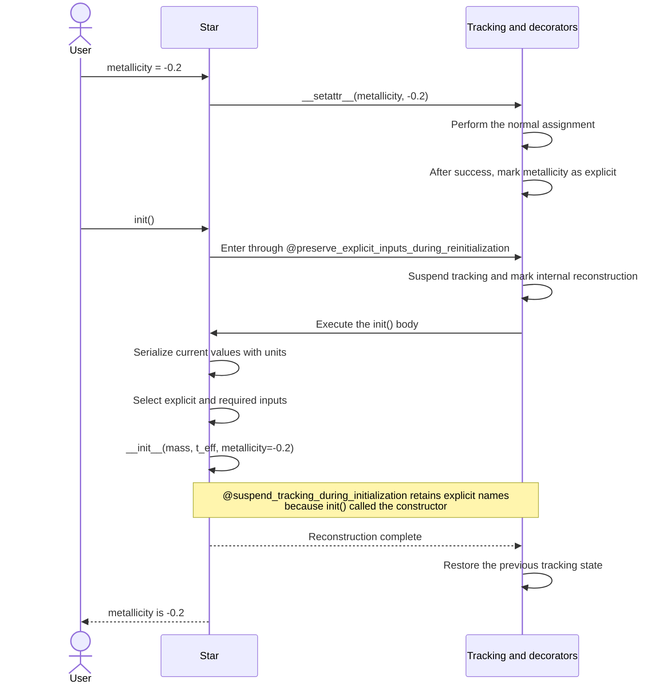
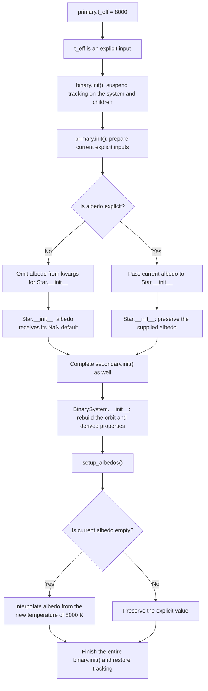
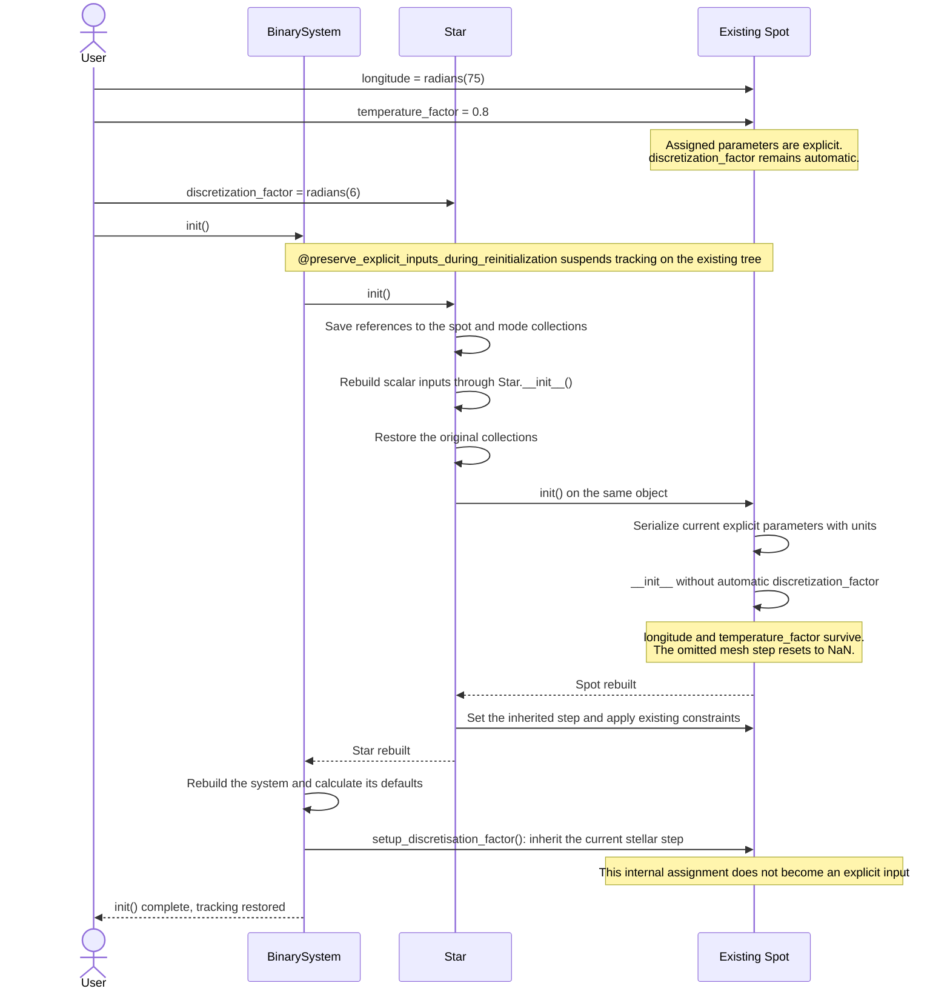
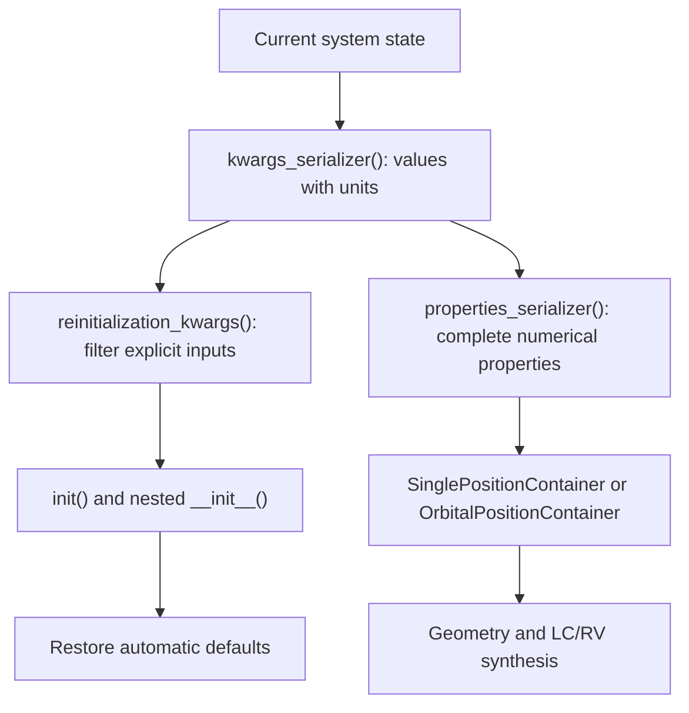

# How parameter tracking and `init()` work

A guide to [parameter_tracking.py](parameter_tracking.py). The examples describe the current implementation
in [Star](star.py), [Spot](spot.py), [BinarySystem](../binary_system/system.py)
and [SingleSystem](../single_system/system.py).

An **explicit parameter** is a parameter supplied to the constructor or assigned later by the user.
Its current value is preserved during `init()`. An **automatic parameter** was omitted, and its value
may be calculated by the parent. Reinitialization restores its default so the parent can recalculate it.

The metadata stores the names of explicit parameters. Values are always read from the current object.

### What “explicit” means

Explicit means that you supplied the value of a constructor parameter in one of these ways:

```python
star = Star(mass=1.2, t_eff=6000, albedo=0.7)  # Constructor input.
star.albedo = 0.7                             # A later direct assignment.
setattr(star, "albedo", 0.7)                   # Equivalent assignment using setattr.
```

Direct edits to existing nested objects also count as explicit inputs:

```python
spot.longitude = 0.7  # Stored angle in radians.
mode.frequency = new_frequency  # In the stored internal units.
```

With `Star(mass=1.2, t_eff=6000)`, albedo is not explicit. If the binary system calculates it,
it remains automatic. After `star.t_eff = 8000` and `binary.init()`, it is recalculated.
However, if you first assign `star.albedo = 0.7`, subsequent calls to `init()` preserve that explicit value.
This also applies when you assign the same value that the system has just calculated.

Explicitness depends on how the value was supplied, not its numerical value. Internal assignments during
protected initialization do not count as explicit inputs. Only accepted constructor parameters are tracked.
JSON and fitting constructors record inputs after conversion to canonical constructor parameters.
Direct assignment retains the existing unit conventions: it uses the stored internal representation,
whereas the constructor may accept different default input units.

## 1. Simple case: change a parameter and call `init()`

```python
from elisa import Star

star = Star(mass=1.2, t_eff=6000)
star.metallicity = -0.2
star.init()

assert star.metallicity == -0.2
```

`metallicity` was omitted at construction. Assigning it adds it to the explicit parameters.
`init()` then uses its current value, `-0.2`, even though it is absent from the original `star.kwargs`.



Internal default assignments during `__init__()` are not recorded as user inputs.
Repeated calls to `init()` therefore do not expand the explicit set to include every current attribute.

## What the decorators do

A decorator wraps the original method: it prepares the tracking state, calls the method body,
and then restores the bookkeeping state. Calculations and validation stay in the original methods.

| Component | Role |
| --- | --- |
| `__setattr__` | Tracks only accepted constructor attributes, after a successful assignment. |
| `@suspend_tracking_during_initialization` | Suspends tracking during a constructor or internal helper. A successful external constructor records a new set of explicit inputs. |
| `@preserve_explicit_inputs_during_reinitialization` | Wraps the entire `init()`. Suspends tracking and marks that the nested `__init__()` must preserve explicit inputs. |
| `suspended()` | Context manager that temporarily suspends tracking on objects and their existing children. |
| `_explicit_parameters` | Names of explicit inputs. |
| `_tracking_depth` | Assignments are not recorded while this value is greater than zero. |
| `_reinitializing` | While this value is greater than zero, the constructor knows it was called by `init()`. |

The two counters have different purposes: disabling assignment recording and deciding whether to preserve
metadata. A direct external `star.__init__(...)` also disables tracking of its internal assignments,
but **replaces** explicit inputs after success. A call through `star.init()` **preserves** them.

## 2. Change the temperature and recalculate albedo

The following example creates a binary system with automatic albedo:

```python
from elisa import BinarySystem, Star

primary = Star(mass=1.2, t_eff=6000, surface_potential=6, synchronicity=1)
secondary = Star(mass=0.8, t_eff=5000, surface_potential=6, synchronicity=1)
binary = BinarySystem(
    primary=primary,
    secondary=secondary,
    inclination=80,
    period=3,
    eccentricity=0.1,
    argument_of_periastron=45,
)

primary.t_eff = 8000
binary.init()
```

When the system is first constructed, `setup_albedos()` calculates albedo. Tracking is suspended during
this calculation, so albedo remains automatic. Changing the temperature triggers this sequence:



If the user previously assigned `primary.albedo = 0.7`, albedo becomes explicit and the diagram follows
the explicit-value branch. This also applies to assignments equal to the current automatic result.
Invalid explicit values are validated during reconstruction; the automatic-default branch does not bypass validation.

Omitted `gravity_darkening` is similarly refreshed through `setup_betas()`.
`primary.init()` alone does not interpolate these physical defaults. The system calculates them.
`SingleSystem.init()` also rebuilds its star, recalculates gravity darkening and computes its potential
from the current `polar_log_g` and mass. Albedo is calculated by the binary system.

### Why suspension must last until the parent finishes

Example tracking depths for a star; individual helpers may add further nested levels:

| Event | Star's `_tracking_depth` | Meaning |
| --- | --- | --- |
| Before `binary.init()` | 0 | User assignments are recorded. |
| Enter `binary.init()` | 1 | The parent also protects the star. |
| Enter `primary.init()` | 2 | The child adds its own suspension. |
| Enter `Star.__init__()` | 3 | The constructor adds another suspension. |
| Return from `Star.__init__()` | 2 | The star's initialization is still running. |
| Return from `primary.init()` | 1 | The parent is still calculating defaults. |
| Return from the entire `binary.init()` | 0 | Assignment recording is active again. |

Each block saves the previous depth and restores it in `finally`, including when an exception occurs.
`visited` prevents repeated entry into the same object within one block.
`yield` in `suspended()` marks where the protected `with` block's body executes.

## 3. Nested case: edit a spot

Add a spot without its own mesh step to the star from the previous example:

```python
import numpy as np

primary.spots = [
    dict(longitude=45, latitude=60, angular_radius=20, temperature_factor=0.9),
]
spot = primary.spots[0]

spot.longitude = np.radians(75)
spot.temperature_factor = 0.8
primary.discretization_factor = np.radians(6)
binary.init()

assert primary.spots[0] is spot
assert spot.temperature_factor == 0.8
```

The constructor accepts bare angles in degrees. Direct assignment uses the stored representation in radians,
which is why the example calls `np.radians`. Reinitialization serialization attaches units before passing
values back to the constructor.



If the spot had its own explicit `discretization_factor`, its current value is passed through reconstruction;
the existing step limit based on the spot's angular radius still applies. An automatic step is derived
from the parent again. Existing objects are preserved during `init()`. To change collection membership,
use the setter with a list of descriptors; it creates new objects and contiguous indices starting at zero.
Direct dictionary insertion or deletion does not establish support for arbitrary indices.
Spot geometry also uses `range(len(spots))`; pulsation calculations directly access mode `0`,
and fitting summaries index both collections numerically. `remove_spot()` only deletes a key and may leave
a gap when removing a spot other than the last one. `init()` does not automatically repair these indices.
A collection setter creates new objects when replacing a collection; identity preservation applies to
existing objects during `init()`, not to collection replacement through a setter.
Standalone `spot.init()` only rebuilds the spot; inherited defaults require subsequent parent initialization.

Pulsation modes follow a similar procedure through their own `init()`: explicit frequencies, amplitudes,
axes and phases are preserved. Omitted `horizontal_to_radial_amplitude_ratio` and
`temperature_amplitude_factor` reset to `None`, and the system calculates them in the context of the current star.
Explicit factors are preserved.

## 4. Two separate serialization paths

**Explicitness determines reconstruction inputs. Numerical calculations need current values, including
defaults and calculated results.** These two paths therefore must not use the same filtering.

| Method | Output | Use |
| --- | --- | --- |
| `kwargs_serializer()` | Current constructor values with their units and existing serialization exceptions. | Complete descriptors and input for further serialization. |
| `properties_serializer()` | Current properties required by the numerical container, including derived state. | Container construction for geometry, LC and RV. |
| `reinitialization_kwargs()` | Current explicit and required inputs; automatic optional defaults are omitted. | Reconstruction through `init()`. |



The diagram shows system serializers. `Star.properties_serializer()` reads its own list of current
attributes directly and also does not filter by explicitness.

### The corrected SingleSystem case

Before the repair, `SingleSystem.properties_serializer()` called `reinitialization_kwargs()`. Once filtering
was introduced, this dropped omitted values such as `distance`, `reference_time`, `phase_shift` and
`additional_light`. It now reads the complete `kwargs_serializer()` output and transforms the values
into the numerical representation required by the container.
`SingleSystem.init()` continues to use the filtered reinitialization path.

```python
import numpy as np
from elisa import SingleSystem, Star

single = SingleSystem(
    star=Star(mass=1.0, t_eff=6000, polar_log_g=4.4),
    inclination=80,
    rotation_period=25,
)

single.init()
state = single.properties_serializer()
inputs = single.reinitialization_kwargs()

assert "distance" in state       # The container also needs the default distance.
assert "distance" not in inputs  # Omitted by the user; the constructor restores its default.
assert state["reference_time"] == 0
assert state["phase_shift"] == 0
assert state["additional_light"] == 0
assert np.isnan(state["gamma"])
```

Omitted, unchanged `gamma` has special existing behavior: complete kwargs contain it as `NaN`
with a velocity unit. When preparing properties, this sentinel is excluded only from input validation
and then restored in the result as numerical `NaN`. Invalid explicit values are not hidden this way.

`Star.kwargs_serializer()` also preserves calculated values of nested objects. For modes, it calls
`PulsationMode.kwargs_serializer()`, which includes current factors; the original exception for
`horizontal_to_radial_amplitude_ratio` with a value of `None` remains in place. Filtered spot and mode
descriptors are prepared only in `reinitialization_kwargs()`.

`Star.init()` retains existing nested objects and calls their own `init()` methods to preserve identity.
JSON export continues to serialize current state; it does not introduce a format for preserving explicitness.

## Limits of the mechanism

Exceptions restore tracking and its counters. This does not guarantee that the entire physical model
returns to its state before the failed calculation. Writing through `__dict__` bypasses the interceptor;
ordinary assignments outside protected internal operations are considered explicit inputs.

Verification includes separate checks of exact keys, types, units and position containers in
[test_state_serialization.py](../../../tests/test_state_serialization.py), as well as comparisons of actual LC
results after repeated `init()` calls against a fresh equivalent model in
[test_parameter_provenance.py](../../../tests/test_parameter_provenance.py).
Agreement between two curves alone is insufficient to verify the serialization contract: both models
could use the same broken serializer and lose the same keys.
